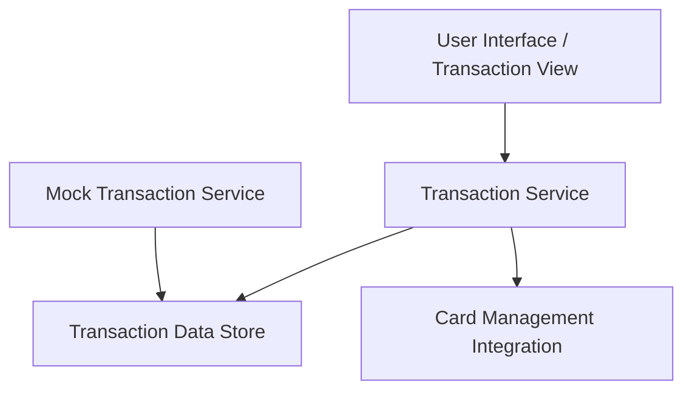

#### 1. High-Level Design

- **Summary:** This epic provides users with comprehensive transaction viewing and monitoring capabilities across all credit cards. Users can access detailed transaction information, review purchase history, and maintain visibility into credit card usage patterns. This forms the foundational data layer for spending behavior analysis and financial trend identification.

- **Component Flow:**

- **Integration Points:**
  - **Upstream:** Credit card transaction data source or mock transaction service for transaction records
  - **Downstream:** Card management system for card-specific transaction filtering
  - **Internal:** Provides transaction data to Spending Analytics and Insights (QE-7584)

- **Key Assumptions:**
  - Transaction data is provided via mock service or API with standard fields (date, amount, merchant, card ID); Transaction history is retained for a reasonable period (assumed 24+ months) for historical access.

- **NFR Highlights:** Transaction data must be displayed with minimal latency; System must handle transaction history for multiple cards efficiently; Interface must be responsive across all device types.

- **Data Flow:** User accesses transaction view → Transaction Service queries Transaction Data Store (populated by Mock Transaction Service) → Service filters transactions by card using Card Management Integration → Transaction Service returns transaction list with details → User views transaction listing and detailed transaction information on responsive interface.

#### 2. Validation Report

- **Requirements Coverage:** The design comprehensively covers the epic's scope including transaction listing, transaction details view, multi-card transaction support, transaction history access, and responsive transaction interface. NFRs regarding minimal latency, efficient handling of multi-card transaction history, and responsive interface are addressed through the Transaction Service architecture and data store design. Dependencies on credit card transaction data source/mock service and card management system integration are explicitly included in the component flow and integration points.