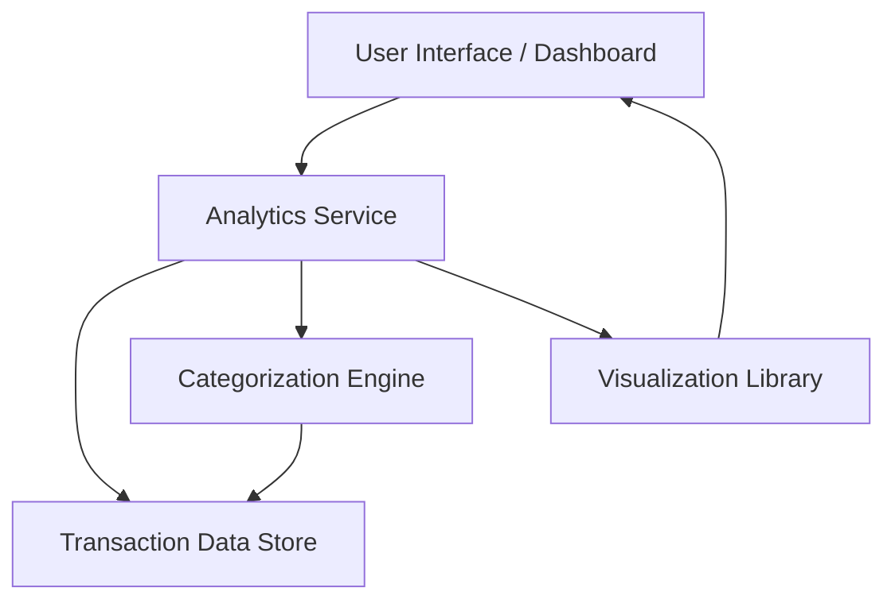

#### 1. High-Level Design

- **Summary:** This epic delivers interactive visualizations and analytical capabilities to help users understand spending patterns through category-wise breakdowns (9 categories: Food & Dining, Fuel, Shopping, Travel, Entertainment, Utilities, Healthcare, Education, Miscellaneous), monthly spend trends, and card-wise analysis. The system provides actionable insights for financial behavior optimization and budget management.

- **Component Flow:**

- **Integration Points:**
  - **Upstream:** Transaction Management system (QE-7583) for transaction data
  - **Downstream:** Data visualization libraries (e.g., Chart.js, D3.js, or similar) for rendering interactive charts
  - Transaction categorization service or logic for assigning spending categories

- **Key Assumptions:**
  - Transaction data is pre-categorized or categorization logic is available via API/service; Historical transaction data is available for at least 12 months for trend analysis.

- **NFR Highlights:** Visualizations must render within 1.5 seconds; Analytics must support real-time data updates; Charts must be interactive and responsive across all devices; System must handle historical data for trend analysis.

- **Data Flow:** User requests analytics via dashboard → Analytics Service fetches transaction data from Transaction Data Store → Categorization Engine assigns/validates categories → Analytics Service aggregates data by category, month, and card → Visualization Library renders interactive charts → User views category-wise spending, monthly trends, and card-wise analysis on the dashboard.

#### 2. Validation Report

- **Requirements Coverage:** The design fully covers the epic's stated scope including category-wise spending visualization (9 categories), monthly spend trends analysis, card-wise spend analysis, interactive charts, and spending pattern identification. All NFRs regarding rendering time (1.5s), real-time updates, responsiveness, and historical data handling are addressed through appropriate architectural components (Analytics Service, Visualization Library, and data aggregation logic). Dependencies on transaction data and categorization service are explicitly acknowledged and integrated into the component flow.