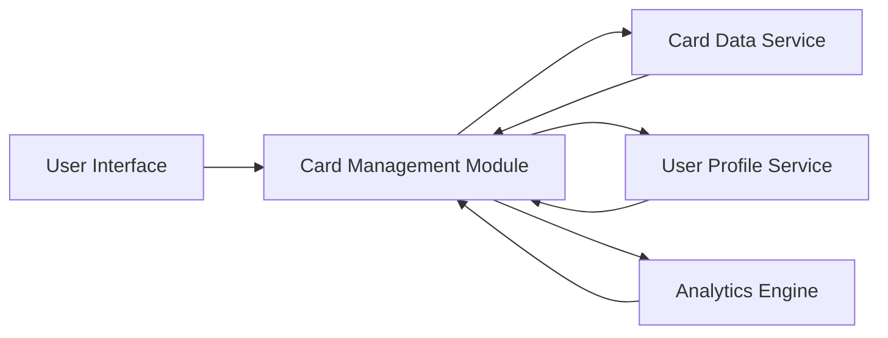

#### 1. High-Level Design

**Summary:** This epic enables users to manage and view multiple credit cards within the dashboard, providing card-specific details, card-wise spend analysis, and comparison capabilities. Users can view individual card performance, spending patterns, and utilization metrics to optimize credit card usage across different cards.

**Component Flow:**

**Integration Points:**
- **Upstream:** User profile service for card-user mapping and ownership validation
- **Downstream:** Credit card data repository or service for retrieving individual card details and transaction data
- **Internal:** Analytics engine for card-wise spend analysis and comparison metrics

**Key Assumptions:**
- Card data is stored with unique identifiers linking cards to user profiles, enabling efficient retrieval and filtering.
- The system supports up to 10 cards per user as specified, with data encryption for secure storage and transmission (TLS/SSL).

**NFR Highlights:** System must handle at least 10 credit cards per user without performance degradation; card data retrieval must complete within 1 second; secure data storage and transmission with encryption required.

#### 2. Validation Report

**Requirements Coverage:** The design fully addresses the epic's scope including multiple card display, card-wise spend analysis, individual card details view, card selection/filtering, card-specific metrics, and comparison capabilities. The component architecture supports scalability for multiple cards and integrates with necessary upstream (user profile) and downstream (card data repository) services. Performance constraints (1-second retrieval) and security requirements (encryption) are explicitly captured in NFRs.