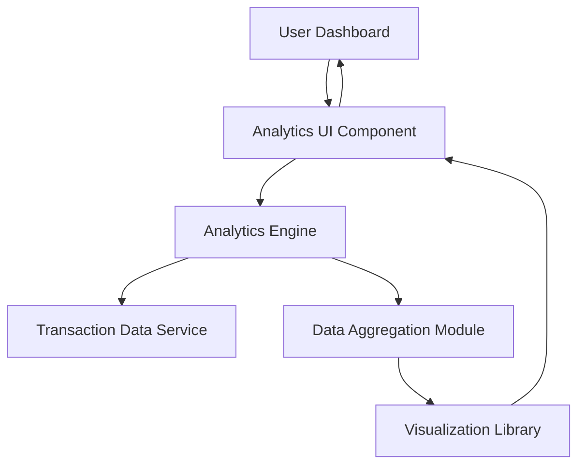

#### 1. High-Level Design

**Summary:** This epic provides comprehensive spending analytics through interactive visualizations and transaction tracking. Users can analyze spending patterns across 9 predefined categories (Food & Dining, Fuel, Shopping, Travel, Entertainment, Utilities, Healthcare, Education, Miscellaneous), view monthly trends, access transaction history, and leverage interactive charts for drill-down analysis to support informed financial decisions.

**Component Flow:**

**Integration Points:**
- **Upstream:** Transaction data service or repository providing historical transaction records with category classifications
- **Downstream:** Analytics engine for data aggregation, processing, and pattern identification
- **External Library:** Charting/visualization library (e.g., D3.js, Chart.js) for rendering interactive charts and graphs

**Key Assumptions:**
- Transactions are pre-categorized into the 9 defined categories at the data source level, or a categorization service exists.
- Historical data is retained for at least 12 months as specified, with monthly aggregation performed for trend analysis.

**NFR Highlights:** Analytics visualizations must render within 3 seconds; system must support at least 12 months of historical transaction data; charts must be interactive and responsive across all device types.

#### 2. Validation Report

**Requirements Coverage:** The design comprehensively covers all functional requirements including category-wise spending visualization (9 categories), monthly spend trends, transaction history display, interactive charts/graphs, spending pattern identification, multi-category breakdown, time-based analysis, and transaction filtering/search. The architecture demonstrates clear data flow from transaction data service through aggregation and analytics processing to visualization rendering. All NFRs are explicitly addressed including 3-second render time, 12-month historical data support, and responsive interactive charts across devices.