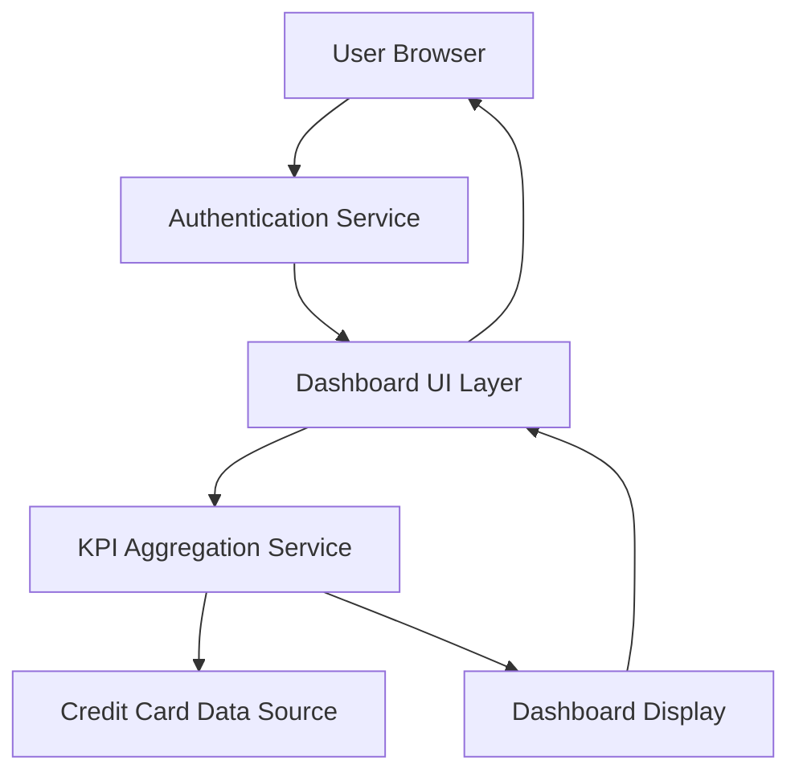

#### 1. High-Level Design

**Summary:** This epic delivers a responsive dashboard that consolidates credit card portfolio information and displays key performance indicators including monthly spend, total credit limit, available credit, and outstanding amounts. The dashboard serves as the primary interface for users to monitor their overall credit card financial health across all cards in a unified view.

**Component Flow:**

**Integration Points:**
- **Upstream:** User authentication service for secure access control
- **Downstream:** Credit card data source or mock data service for retrieving card portfolio information and financial metrics
- **UI Framework:** Responsive design framework supporting desktop, tablet, and mobile devices

**Key Assumptions:**
- Credit card data is available in real-time or near-real-time from the data source with standardized data formats (JSON/REST API).
- User authentication is handled by an existing enterprise authentication service with session management capabilities.

**NFR Highlights:** Dashboard must load within 2 seconds; responsive design across desktop, tablet, and mobile devices; WCAG 2.1 accessibility compliance required.

#### 2. Validation Report

**Requirements Coverage:** The design adequately covers all stated requirements including KPI display (monthly spend, credit limit, available credit, outstanding amount), responsive layout, multi-card consolidated view, and integration with authentication and data services. The component flow demonstrates clear separation of concerns between UI, business logic (aggregation), and data layers. Performance requirements (2-second load time) and accessibility standards (WCAG 2.1) are explicitly addressed in the NFR constraints.