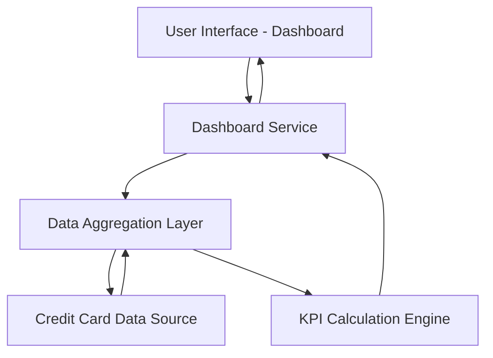

#### 1. High-Level Design

- **Summary:** This epic enables users to view a consolidated dashboard displaying key performance indicators across all their credit cards. Users can monitor critical financial metrics including monthly spend, total credit limit, available credit, and outstanding amounts in a single unified interface. The dashboard provides a comprehensive snapshot of the user's credit card portfolio for informed financial decision-making and credit utilization tracking.

- **Component Flow:**

- **Integration Points:** 
  - **Upstream:** Credit card data source or mock data service for retrieving card information, balances, and limits
  - **Downstream:** None explicitly mentioned; outputs to dashboard user interface

- **Key Assumptions:** 
  - KPI calculations (monthly spend, available credit, outstanding amount) are computed in real-time or near real-time based on current card data
  - Multiple credit cards per user are supported with aggregated portfolio-level KPIs

- **NFR Highlights:** Dashboard must be responsive across desktop, tablet, and mobile devices; Page load time must be optimized for quick access to financial data; Data refresh must occur in real-time or near real-time to reflect current balances

- **Data Flow:** User accesses dashboard → Dashboard Service requests data from Data Aggregation Layer → Data Aggregation Layer retrieves card information, balances, and limits from Credit Card Data Source → KPI Calculation Engine computes monthly spend, total credit limit, available credit, and outstanding amounts across all cards → Calculated KPIs are returned to Dashboard Service → Dashboard displays consolidated KPIs and credit card portfolio overview to user

#### 2. Validation Report

- **Requirements Coverage:** The design covers all scope items including dashboard KPI displays for monthly spend, total credit limit, available credit, outstanding amount, multiple credit card view, and consolidated portfolio interface. The architecture supports the NFRs for responsive design across devices, optimized page load time, and real-time/near real-time data refresh. Integration dependency with credit card data source is addressed.