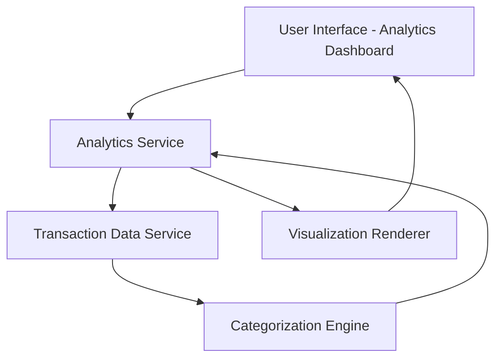

#### 1. High-Level Design

- **Summary:** This epic delivers interactive visualizations and analytics capabilities that help users understand their spending patterns through category-wise analysis and monthly spend trends. Users can explore spending across predefined categories (Food & Dining, Fuel, Shopping, Travel, Entertainment, Utilities, Healthcare, Education, Miscellaneous) and perform card-wise spend analysis to compare spending across different credit cards and identify trends over time.

- **Component Flow:**

- **Integration Points:** 
  - **Upstream:** Transaction data service for aggregating and categorizing spending data
  - **Downstream:** Charting library or visualization framework for rendering interactive analytics

- **Key Assumptions:** 
  - Transaction categorization will be automated based on merchant codes or predefined rules; categories are fixed to the nine predefined categories listed in scope
  - Historical data for monthly trends is available for at least 12 months

- **NFR Highlights:** Visualizations must render quickly and smoothly; Charts must be interactive and responsive; Analytics calculations must be accurate and performant even with large datasets

- **Data Flow:** User requests analytics view → Analytics Service queries Transaction Data Service for transaction records → Categorization Engine processes and groups transactions by category and card → Aggregated data is returned to Analytics Service → Visualization Renderer generates interactive charts and graphs → Rendered visualizations are displayed to user in the Analytics Dashboard

#### 2. Validation Report

- **Requirements Coverage:** The design covers all stated scope items including category-wise spending visualization, monthly spend trend analysis, card-wise spend analysis, and interactive charts. The component architecture supports the NFRs for performance, responsiveness, and accuracy. Integration dependencies with transaction data service and visualization framework are addressed.