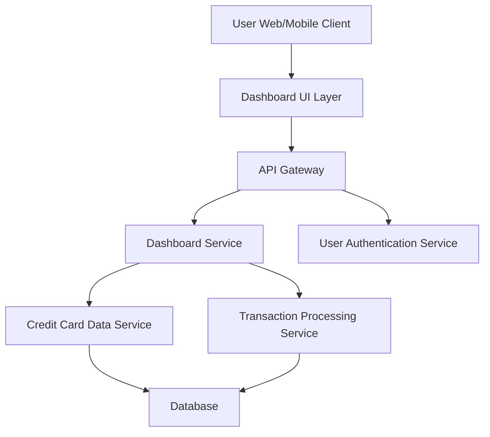

#### 1. High-Level Design

- **Summary:** This epic delivers a centralized, responsive dashboard that aggregates and displays key financial metrics across multiple credit cards. Users can view monthly spend, total credit limit, available credit, and outstanding amounts in a unified interface, providing instant visibility into their credit card portfolio and overall financial health.

- **Component Flow:**

- **Integration Points:** 
  - **Upstream:** User Authentication Service (for secure user access and session management)
  - **Downstream:** Credit Card Data Service (retrieves card details, limits, and balances), Transaction Processing Service (calculates monthly spend and outstanding amounts)

- **Key Assumptions:** 
  - Data refresh frequency is assumed to be near-real-time (within 5-10 seconds) rather than true real-time streaming.
  - Credit card data is assumed to be pre-aggregated and available via REST APIs from backend services.

- **NFR Highlights:** Dashboard must be responsive across desktop, tablet, and mobile devices; page load time optimized for quick access; supports near-real-time data refresh for accurate financial metrics.

- **Data Flow:** User authenticates via Authentication Service → Dashboard UI requests aggregated KPI data via API Gateway → Dashboard Service orchestrates calls to Credit Card Data Service (for card details, limits, balances) and Transaction Processing Service (for monthly spend, outstanding amounts) → Services query Database and return data → Dashboard Service aggregates and formats response → UI renders KPIs in responsive layout with periodic refresh capability.

#### 2. Validation Report

- **Requirements Coverage:** The design fully covers the epic's stated scope including dashboard interface, monthly spend display, credit limit aggregation, available credit calculation, outstanding amount tracking, multiple card view, and responsive layout. All NFRs regarding responsiveness, load time optimization, and data refresh are addressed through the layered architecture and service integration pattern.