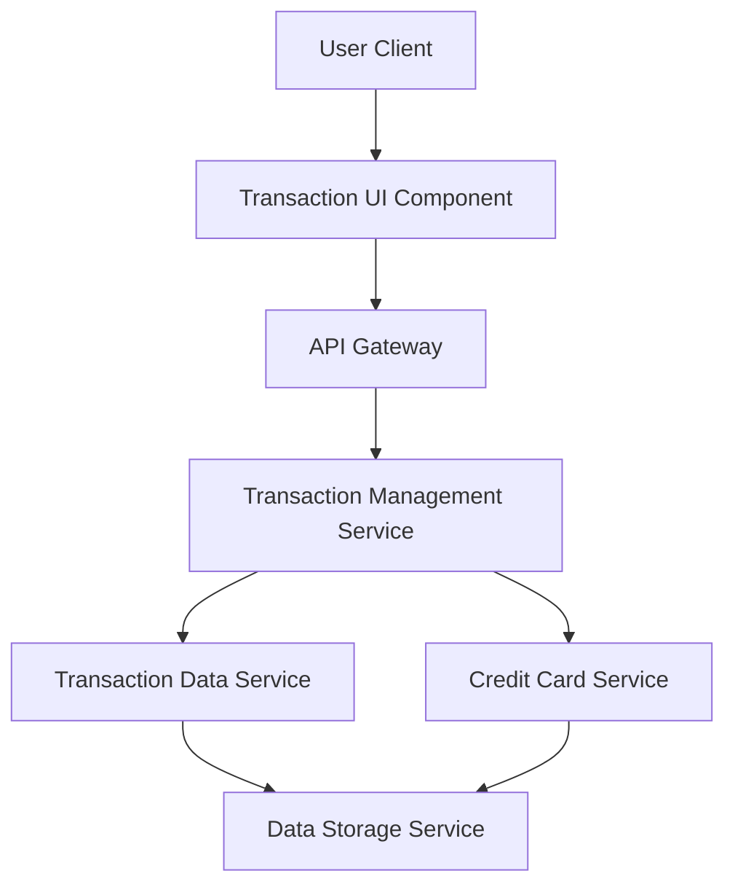

#### 1. High-Level Design

- **Summary:** This epic enables comprehensive transaction viewing, tracking, and monitoring across all user credit cards. Users can access detailed transaction history, search and filter transactions, and review individual purchase details to maintain transparency and control over their spending activities.

- **Component Flow:**

- **Integration Points:** 
  - **Upstream:** User authentication (inherited from dashboard/session management)
  - **Downstream:** Transaction Data Service (retrieves transaction records and history), Credit Card Service (associates transactions with specific cards), Data Storage Service (persists and queries transaction history)

- **Key Assumptions:** 
  - Transaction data is stored in a queryable format supporting efficient search and filter operations (e.g., indexed by date, card, amount).
  - Transaction details include standard fields such as merchant name, date, amount, category, and card identifier.

- **NFR Highlights:** System must handle high transaction volumes efficiently; transaction data displayed accurately and consistently; search and filter operations return results within acceptable response times (assumed <2 seconds for typical queries).

- **Data Flow:** User navigates to transaction view → UI requests transaction list via API Gateway → Transaction Management Service queries Transaction Data Service with filters (date range, card, search terms) → Service retrieves data from Data Storage and associates with card details from Credit Card Service → Aggregated transaction list returned to UI → User can drill down into individual transaction details → Detail view fetches additional information and displays comprehensive transaction record.

#### 2. Validation Report

- **Requirements Coverage:** The design addresses all scope elements including transaction listing, details view, multi-card aggregation, search/filtering, and history access. NFRs for high volume handling, data accuracy, and acceptable response times are supported through dedicated Transaction Management Service with optimized data storage and retrieval patterns. The architecture supports scalability and performance requirements through service separation and efficient data access patterns.