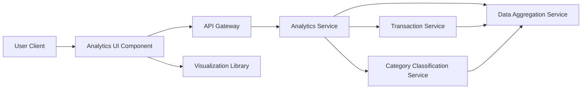

#### 1. High-Level Design

- **Summary:** This epic provides interactive visualizations and analytics to help users understand spending patterns through category-wise breakdowns and monthly trend analysis. Users can view expenses across nine predefined categories (Food & Dining, Fuel, Shopping, Travel, Entertainment, Utilities, Healthcare, Education, Miscellaneous) with card-wise comparisons and historical trend visualization for informed financial decision-making.

- **Component Flow:**

- **Integration Points:** 
  - **Upstream:** Dashboard and Transaction Management (user context and navigation)
  - **Downstream:** Transaction Service (raw spending data), Category Classification Service (transaction categorization logic), Data Aggregation Service (computes spending metrics and trends), Visualization Library (client-side chart rendering)

- **Key Assumptions:** 
  - Transactions are pre-classified or classified on-the-fly into one of the nine predefined categories using rule-based or ML-based categorization.
  - Historical data is retained for at least 12-24 months to support meaningful trend analysis.

- **NFR Highlights:** Visualizations must render quickly and be responsive across all device types; analytics calculations accurate and reflect up-to-date transaction data; charts interactive and support user engagement.

- **Data Flow:** User accesses analytics view → UI requests aggregated spending data via API Gateway → Analytics Service retrieves raw transactions from Transaction Service → Category Classification Service categorizes transactions into predefined categories → Data Aggregation Service computes category totals, monthly trends, and card-wise breakdowns → Aggregated data returned to UI → Visualization Library renders interactive charts (pie charts for categories, line/bar charts for trends) → User interacts with visualizations to drill down into specific categories or time periods → UI requests filtered data and updates visualizations dynamically.

#### 2. Validation Report

- **Requirements Coverage:** The design comprehensively covers all scope elements including category-wise visualization, monthly trend analysis, card-wise comparison, interactive charts, spending pattern identification across nine categories, and historical data analysis. NFRs for quick rendering, responsive design, data accuracy, and interactivity are addressed through client-side visualization library integration and efficient backend aggregation services. The architecture supports the analytical workload through dedicated aggregation services and separation of concerns between data processing and presentation layers.