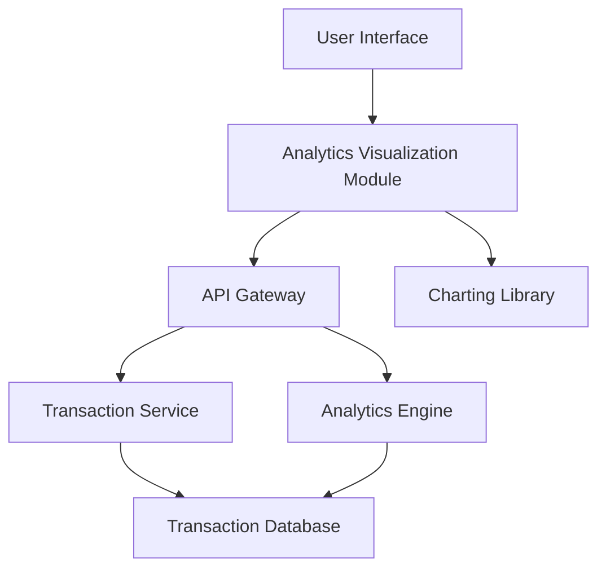

#### 1. High-Level Design

- **Summary:** This epic provides interactive visualizations and analytics for users to understand spending patterns across predefined categories (Food & Dining, Fuel, Shopping, Travel, Entertainment, Utilities, Healthcare, Education, Miscellaneous). Users can analyze monthly spend trends, view category-wise breakdowns, and identify optimization opportunities through actionable insights for financial planning.

- **Component Flow:**

- **Integration Points:**
  - **Upstream:** Transaction Service (for transaction data and categorization)
  - **Upstream:** Analytics Engine (for data aggregation and trend calculations)
  - **Upstream:** Third-party charting libraries (for interactive visualizations)
  - **Downstream:** UI renders interactive charts and graphs with responsive design

- **Key Assumptions:**
  - Transactions are pre-categorized by the Transaction Service or categorized on-demand using rule-based logic.
  - Historical data for 12 months is indexed and optimized for fast analytical queries (sub-1 second).

- **NFR Highlights:** Analytics queries must execute within 1 second; support visualization of at least 12 months of historical data; charts must be interactive and responsive across all device types.

#### 2. Validation Report

- **Requirements Coverage:** The design comprehensively covers all scope elements including category-wise spending visualization, monthly spend trends analysis, interactive charts and graphs, spending pattern identification, multi-category breakdown, transaction categorization, and time-based spending comparisons. The architecture integrates with Transaction Service and Analytics Engine as specified in dependencies, with provision for third-party charting libraries. The component flow supports the NFR requirements for sub-1 second query execution, 12-month historical data visualization, and responsive interactive charts across devices.