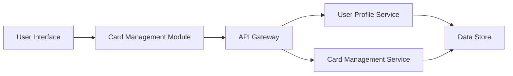

#### 1. High-Level Design

- **Summary:** This epic enables users to view and manage multiple credit cards within a single interface, providing card-wise spend analysis, individual card details, status monitoring, and credit limit information. Users can seamlessly switch between cards and gain comprehensive visibility into each card's performance and utilization.

- **Component Flow:**

- **Integration Points:**
  - **Upstream:** User Profile Service (for card ownership validation)
  - **Upstream:** Card Management Service (for card details and metadata)
  - **Downstream:** UI layer displays aggregated multi-card data with filtering and selection capabilities

- **Key Assumptions:**
  - Card data is retrieved in batch for all user-owned cards to meet the 500ms performance requirement.
  - Card ownership is validated via JWT token or session-based authentication linked to User Profile Service.

- **NFR Highlights:** System must support management of at least 10 credit cards per user; card data retrieval must complete within 500ms; ensure data isolation and security for multi-card views.

#### 2. Validation Report

- **Requirements Coverage:** The design addresses all scope elements including multiple credit card display, card-wise spend analysis, individual card details view, card status monitoring, credit limit per card, and card selection and filtering. The architecture integrates with User Profile Service and Card Management Service as specified in dependencies. The component flow supports the NFR requirements for handling 10+ cards per user, sub-500ms retrieval times, and data isolation through proper service boundaries and authentication.