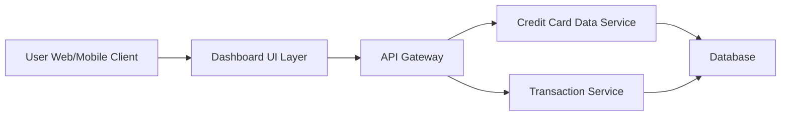

#### 1. High-Level Design

- **Summary:** This epic delivers a consolidated dashboard that displays key performance indicators (KPIs) for the user's credit card portfolio, including monthly spend, total credit limit, available credit, and outstanding amounts. The dashboard provides real-time visibility into financial health and credit utilization across all credit cards through a modern, responsive interface.

- **Component Flow:**

- **Integration Points:**
  - **Upstream:** Credit Card Data Service (for card details and balances)
  - **Upstream:** Transaction Service (for monthly spend calculations)
  - **Downstream:** User interface consumes aggregated KPI data via API Gateway

- **Key Assumptions:**
  - KPI data is aggregated server-side and delivered as JSON via REST API.
  - Real-time refresh is implemented via polling or WebSocket with configurable intervals.

- **NFR Highlights:** Dashboard must be responsive across desktop, tablet, and mobile devices; page load time under 2 seconds; support real-time data refresh for KPI metrics.

#### 2. Validation Report

- **Requirements Coverage:** The design covers all stated scope elements including dashboard KPIs display, monthly spend tracking, total credit limit aggregation, available credit calculation, outstanding amount monitoring, responsive layout design, and multi-card consolidated view. Integration dependencies with Credit Card Data Service and Transaction Service are addressed through the API Gateway pattern. The architecture supports the specified NFRs for responsiveness, load time, and real-time refresh capabilities.