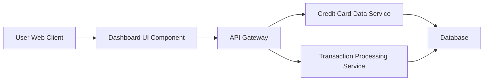

### 1. High-Level Design

**Summary:** This epic delivers a consolidated dashboard that displays key performance indicators (KPIs) for the user's credit card portfolio. Users can monitor monthly spend, total credit limit, available credit, and outstanding amounts across all their credit cards through a modern, responsive interface. The dashboard provides immediate visibility into overall credit card financial health.

**Component Flow:**

**Integration Points:**
- **Upstream:** Credit Card Data Service (retrieves card details and balances)
- **Upstream:** Transaction Processing Service (calculates monthly spend and outstanding amounts)
- **Data Store:** Database for persistent credit card and transaction data

**Key Assumptions:**
- Data refresh mechanism will use polling or event-driven updates to achieve near real-time synchronization (specific implementation not detailed in epic).
- Available credit is calculated as (Total Credit Limit - Outstanding Amount) on the backend service.

**NFR Highlights:** Dashboard must load within 2 seconds; responsive design across desktop, tablet, and mobile devices; real-time or near real-time data refresh.

### 2. Validation Report

**Requirements Coverage:** The design fully covers the epic's stated scope including dashboard KPIs display, monthly spend tracking, total credit limit display, available credit calculation, outstanding amount tracking, multiple credit card view, and responsive layout design. All specified NFRs (2-second load time, responsive design, modern UI, real-time refresh) are addressed through the architecture with dedicated services for data retrieval and processing.