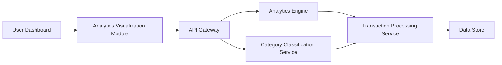

### 1. High-Level Design

**Summary:** This epic delivers interactive analytics and visualization capabilities that help users understand spending patterns through category-wise analysis and monthly spend trends. Users can view spending breakdowns across nine predefined categories (Food & Dining, Fuel, Shopping, Travel, Entertainment, Utilities, Healthcare, Education, Miscellaneous) and perform card-wise spend analysis for better financial management and budgeting decisions.

**Component Flow:**

**Integration Points:**
- **Upstream:** Transaction Processing Service (provides raw transaction data)
- **Upstream:** Analytics Engine (performs data aggregation and calculations)
- **Upstream:** Category Classification Service (maps transactions to nine spending categories)
- **Data Store:** Data warehouse or database for historical transaction data (up to 12 months)

**Key Assumptions:**
- Category classification logic is pre-defined and maintained in the Category Classification Service (merchant codes or transaction descriptions used for mapping).
- Analytics Engine performs pre-aggregation or caching to meet the 2-second rendering requirement for visualizations.

**NFR Highlights:** Analytics visualizations must render within 2 seconds; charts must be interactive with drill-down capabilities; support data aggregation for up to 12 months of historical data; responsive across all device types.

### 2. Validation Report

**Requirements Coverage:** The design fully addresses the epic's scope including category-wise spending visualization, monthly spend trends analysis, card-wise spend analysis, interactive charts and graphs, spending pattern identification, and multi-dimensional spending breakdowns across nine categories. All NFRs are architecturally supported through the Analytics Engine for fast aggregation, Category Classification Service for accurate categorization, and responsive visualization components. The 2-second rendering requirement and 12-month historical data support are enabled through optimized data aggregation and caching strategies.