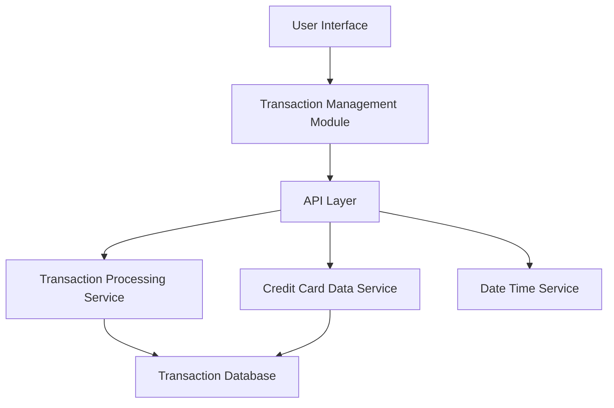

### 1. High-Level Design

**Summary:** This epic provides comprehensive transaction management capabilities allowing users to view, track, and monitor all credit card transactions across multiple credit cards. Users can access detailed transaction histories, view transaction details, filter and search transactions, and understand spending patterns through transaction-level data with complete transparency.

**Component Flow:**

**Integration Points:**
- **Upstream:** Transaction Processing Service (retrieves transaction data)
- **Upstream:** Credit Card Data Service (maps transactions to specific cards)
- **Upstream:** Date/Time Service (manages transaction timestamps)
- **Data Store:** Transaction Database for historical transaction records

**Key Assumptions:**
- Pagination will be implemented with a default page size (e.g., 50 transactions per page) to handle the 1000-transaction load requirement.
- Transaction data format and schema are standardized across all integrated credit card sources.

**NFR Highlights:** Transaction list must load within 3 seconds for up to 1000 transactions; system must handle concurrent queries from multiple users; chronological order with pagination support.

### 2. Validation Report

**Requirements Coverage:** The design comprehensively addresses all scope items including transaction listing, transaction details view, multi-card transaction aggregation, transaction filtering, search functionality, and transaction history access. The architecture supports the specified NFRs through dedicated services for transaction processing, card mapping, and timestamp management. Pagination and concurrent query handling are architecturally supported through the API layer and Transaction Processing Service.