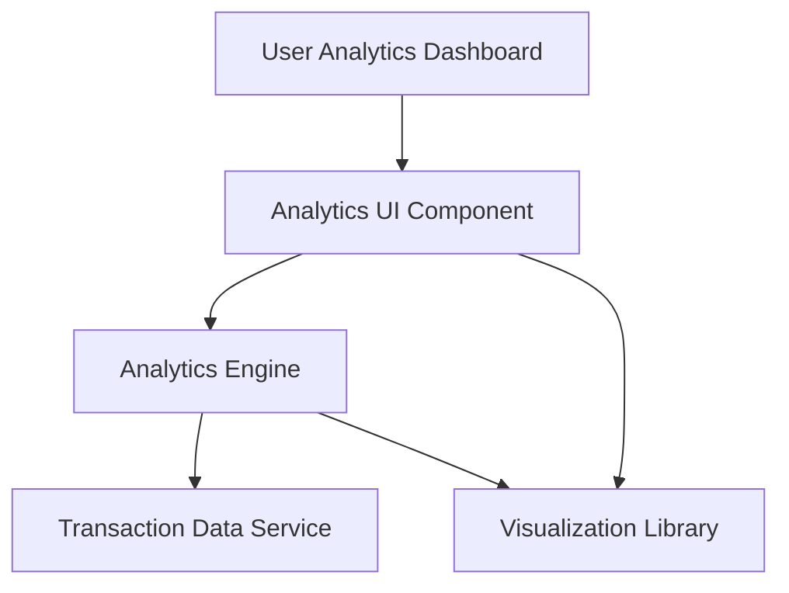

#### 1. High-Level Design

- **Summary:** This epic provides interactive analytics and visualization capabilities that enable users to understand their spending patterns through category-wise analysis and monthly trend tracking. Users can view spending broken down across nine predefined categories (Food & Dining, Fuel, Shopping, Travel, Entertainment, Utilities, Healthcare, Education, and Miscellaneous) and visualize monthly spend trends over time to identify patterns and make informed financial decisions based on historical data.

- **Component Flow:**

- **Integration Points:**
  - **Upstream:** Transaction Data Service (for retrieving raw transaction data with timestamps and amounts)
  - **Downstream:** Analytics Engine (for data aggregation, categorization, and calculation of spending trends)
  - **External:** Visualization Library (for rendering interactive charts and graphs)

- **Key Assumptions:**
  - Transactions are pre-categorized or categorized automatically by the Transaction Data Service into the nine defined categories.
  - Historical data for at least 12 months is readily available and accessible from the Transaction Data Service with acceptable query performance.

- **NFR Highlights:** Analytics visualizations must render within 3 seconds; support interactive chart interactions with sub-second response times; handle historical data for at least 12 months.

#### 2. Validation Report

- **Requirements Coverage:** The design fully addresses the epic's scope including category-wise spending visualization, monthly spend trend charts, interactive analytics dashboard, nine spending categories tracking, historical spending data display, and card-wise spend analysis. All three key dependencies (Transaction Data Service, Analytics Engine, and Visualization Library) are incorporated into the architecture. The NFRs for 3-second visualization rendering, sub-second interactive response times, and 12-month historical data support are explicitly addressed through the component design and data flow architecture.