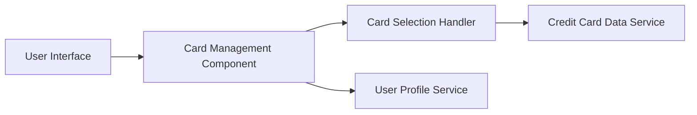

#### 1. High-Level Design

- **Summary:** This epic enables users to manage and view multiple credit cards within a unified dashboard interface. Users can view all their credit cards with relevant details, switch between cards, access card-specific information, and perform card-wise spend analysis. The feature provides a consolidated view that simplifies portfolio management by allowing users to track and compare multiple credit cards from one centralized location.

- **Component Flow:**

- **Integration Points:**
  - **Upstream:** User Profile Service (for linking credit cards to user accounts and managing user-card relationships)
  - **Downstream:** Credit Card Data Service (for retrieving detailed card information, balances, and transaction data for each card)

- **Key Assumptions:**
  - Card data is cached locally after initial load to achieve sub-500ms card switching response time.
  - User-card associations are maintained and validated through the User Profile Service with each session.

- **NFR Highlights:** System must support display of up to 50 credit cards per user; card switching response time must be under 500ms; secure card data handling and display.

#### 2. Validation Report

- **Requirements Coverage:** The design comprehensively addresses the epic's scope including multiple credit card display, card listing interface, card selection functionality, card-wise spend analysis, and card detail views. The architecture incorporates both required dependencies (Credit Card Data Service and User Profile Service) and supports the NFRs for handling up to 50 cards per user, sub-500ms card switching, and secure data handling through appropriate service layer abstractions.