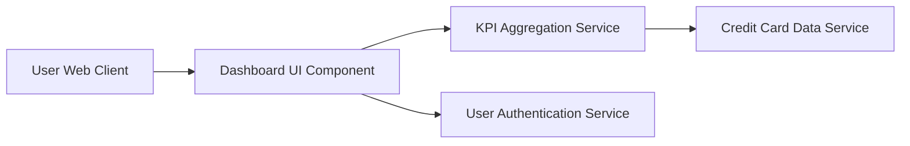

#### 1. High-Level Design

- **Summary:** This epic delivers a consolidated dashboard that displays key performance indicators (KPIs) for all user credit cards in a single interface. The dashboard aggregates and presents critical financial metrics including monthly spend, total credit limit, available credit, and outstanding amounts, providing users with immediate visibility into their credit card portfolio health through a modern, responsive interface.

- **Component Flow:**

- **Integration Points:**
  - **Upstream:** User Authentication Service (for secure user access and session management)
  - **Downstream:** Credit Card Data Service (for retrieving card information, balances, and transaction data)

- **Key Assumptions:** 
  - KPI data is refreshed in near real-time or at defined intervals (e.g., every 5 minutes) from the Credit Card Data Service.
  - Card balance and transaction data are provided in a standardized JSON format by the Credit Card Data Service.

- **NFR Highlights:** Dashboard must load within 2 seconds; support responsive design for mobile and desktop devices; handle concurrent users viewing real-time KPI data.

#### 2. Validation Report

- **Requirements Coverage:** The design fully covers the epic's stated scope including dashboard KPI display, monthly spend tracking, total credit limit aggregation, available credit calculation, outstanding amount display, and responsive layout design. The component flow addresses the integration with Credit Card Data Service and User Authentication Service as specified in dependencies. All NFRs regarding load time (2 seconds), responsive design, and concurrent user support are accounted for in the architecture.