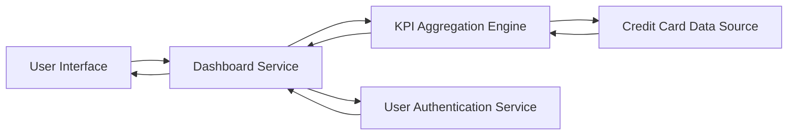

#### 1. High-Level Design

- **Summary:** This epic delivers a modern, responsive dashboard serving as the central hub for credit card management. It provides users with a consolidated view of their credit card portfolio and displays critical KPIs including monthly spend, total credit limit, available credit, and outstanding amounts across all credit cards. The dashboard enables real-time monitoring of financial health through an intuitive interface.

- **Component Flow:**

- **Integration Points:**
  - **Upstream:** Credit card data source system (provides raw credit card data, balances, limits, and transaction information)
  - **Upstream:** User authentication service (validates user identity and access permissions)
  - **Downstream:** Provides aggregated KPI data to other modules requiring consolidated credit card metrics

- **Key Assumptions:**
  - Credit card data is provided in a standardized format (JSON/XML) via REST API with fields for card ID, limit, outstanding balance, and available credit.
  - KPI calculations (aggregations) are performed server-side with caching to meet the 2-second load time requirement.

- **NFR Highlights:** Dashboard must load within 2 seconds; responsive design across desktop, tablet, and mobile devices; real-time data refresh capability; support concurrent viewing of multiple credit cards.

#### 2. Validation Report

- **Requirements Coverage:** The design fully covers the epic's stated scope including dashboard KPI display, monthly spend tracking, credit limit aggregation, available credit calculation, outstanding amount monitoring, multi-card consolidated view, and responsive layout design. The architecture supports all specified NFRs through the KPI Aggregation Engine (for performance) and responsive UI layer (for multi-device support). All integration dependencies are addressed through defined upstream connections to credit card data source and authentication service.