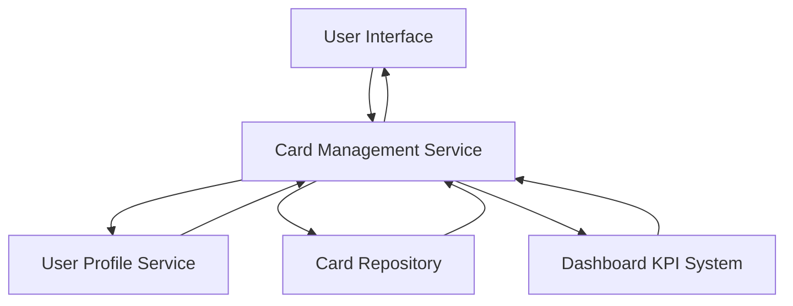

#### 1. High-Level Design

- **Summary:** This epic enables users to view and manage multiple credit cards within a single interface. It provides card-specific details including credit limits, outstanding balances, and available credit for each card. The feature delivers card-wise spend analysis, allowing users to track each card's utilization independently while maintaining an overall portfolio view, supporting users who maintain multiple cards for different purposes.

- **Component Flow:**

- **Integration Points:**
  - **Upstream:** Credit card data repository (provides individual card details, balances, limits, and transaction history)
  - **Upstream:** User profile service (retrieves user-specific card associations and preferences)
  - **Lateral:** Dashboard KPI system (exchanges data for consolidated portfolio view and individual card metrics)

- **Key Assumptions:**
  - Each user can have up to 10 credit cards linked to their profile, with card data retrieved via batch API calls optimized for 1-second response time.
  - Card comparison logic is implemented client-side using cached data to maintain interface responsiveness as the number of cards increases.

- **NFR Highlights:** System must support display of at least 10 credit cards per user; card data retrieval must complete within 1 second; interface must maintain usability with increasing number of cards.

#### 2. Validation Report

- **Requirements Coverage:** The design comprehensively addresses the epic's scope including multiple credit card display, card-wise spend analysis, individual card credit limit tracking, card-specific outstanding balance view, card-specific available credit display, and card comparison capability. The Card Management Service architecture ensures all NFRs are met through optimized data retrieval and scalable UI design. All integration dependencies with credit card data repository, user profile service, and dashboard KPI system are explicitly addressed in the component flow.