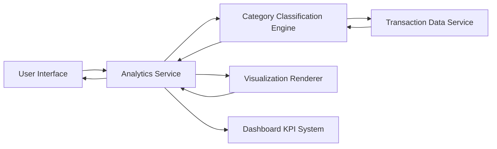

#### 1. High-Level Design

- **Summary:** This epic delivers comprehensive spending analytics through interactive visualizations that help users understand their spending behavior. The system provides category-wise spending analysis across nine predefined categories (Food & Dining, Fuel, Shopping, Travel, Entertainment, Utilities, Healthcare, Education, Miscellaneous), monthly spend trend analysis, and enables users to drill down into specific categories and time periods for detailed insights into financial habits.

- **Component Flow:**

- **Integration Points:**
  - **Upstream:** Transaction data service (provides raw transaction records with amounts, timestamps, and merchant information)
  - **Upstream:** Credit card transaction history (historical transaction data for trend analysis up to 12 months)
  - **Upstream:** Category classification engine (categorizes transactions into nine predefined spending categories)
  - **Lateral:** Dashboard KPI system (provides monthly spend totals and aggregated metrics for visualization context)

- **Key Assumptions:**
  - Transactions are auto-categorized using merchant codes (MCC) or merchant names with 90%+ accuracy; users can manually recategorize if needed.
  - Visualization data is pre-aggregated daily and cached to meet the 3-second rendering requirement while supporting real-time updates for current-day transactions.

- **NFR Highlights:** Visualization rendering must complete within 3 seconds; system must handle transaction data for up to 12 months; charts must be interactive and responsive across all device types; support for real-time data updates in visualizations.

#### 2. Validation Report

- **Requirements Coverage:** The design fully addresses the epic's scope including category-wise spending visualization, monthly spend trend analysis, interactive charts and graphs, nine spending categories tracking, spending pattern identification, time-based spending comparison, and transaction categorization. The architecture with dedicated Analytics Service, Category Classification Engine, and Visualization Renderer ensures all NFRs are met including 3-second rendering time, 12-month data handling, and cross-device responsiveness. All integration dependencies with transaction data service, credit card transaction history, category classification engine, and dashboard KPI system are properly incorporated into the component flow.