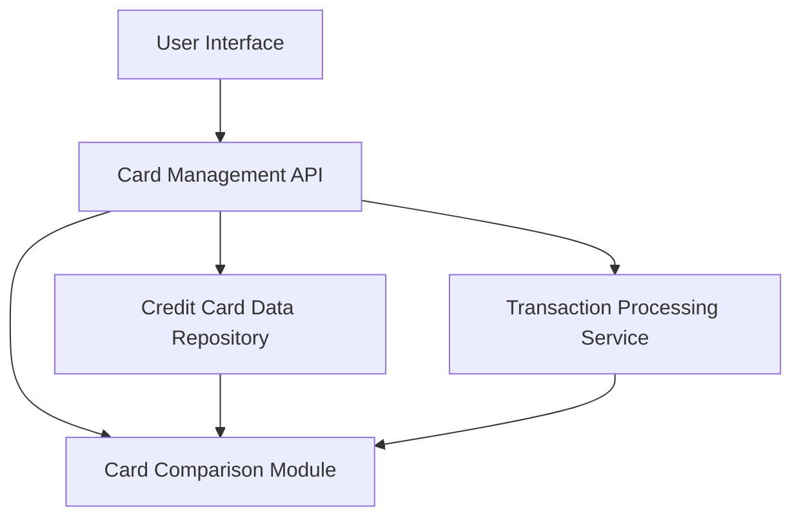

### 1. High-Level Design

**Summary:**  
This epic enables users to manage and monitor up to 20 credit cards with detailed card-specific information including spending, limits, and balances. It provides card-wise spend analysis for comparing usage patterns across cards, individual card detail views, and card comparison capabilities to optimize credit card usage strategy.

**Component Flow:**

**Integration Points:**
- **Upstream:** Credit Card Data Repository (stores and retrieves card information including limits, balances, status)
- **Upstream:** Transaction Processing Service (provides card-specific spending data and transaction history)
- **Internal:** Card Comparison Module (enables side-by-side card performance analysis)

**Key Assumptions:**
- Card data updates are synchronized across all modules within 1 second of any transaction posting. Each card record includes standardized metadata (card type, issuer, reward program) for comparison purposes.

**NFR Highlights:**  
System supports up to 20 credit cards per user; card data retrieval completes within 1 second per card; handles concurrent updates to multiple card records.

### 2. Validation Report

**Requirements Coverage:**  
The design comprehensively covers all scope items including multiple credit card display and management, card-wise spend analysis, individual card detail views, card-specific balance tracking, card comparison capabilities, and card status indicators. NFRs for supporting 20 cards per user, 1-second retrieval time per card, and concurrent update handling are addressed through the architecture. Dependencies on credit card data repository and transaction processing service are properly mapped and integrated into the component flow.