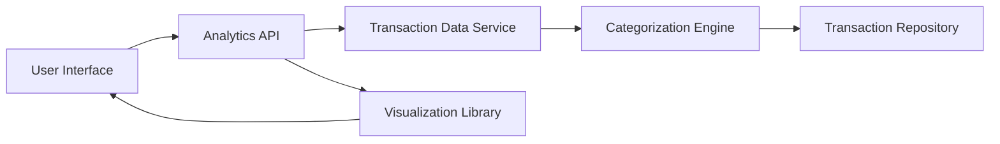

### 1. High-Level Design

**Summary:**  
This epic provides interactive visualizations and analytics to help users understand spending patterns across 9 predefined categories (Food & Dining, Fuel, Shopping, Travel, Entertainment, Utilities, Healthcare, Education, Miscellaneous). It includes monthly spend trend analysis with historical comparison, enabling users to identify high-expenditure areas and cost-saving opportunities through intuitive charts and graphs.

**Component Flow:**

**Integration Points:**
- **Upstream:** Transaction Data Service (provides raw transaction records for analysis)
- **Upstream:** Categorization Engine (automatic classification of transactions into 9 categories)
- **Internal:** Data Visualization Library (renders interactive charts and graphs)

**Key Assumptions:**
- Transactions are pre-categorized or categorization happens asynchronously with <1 second latency. Historical data is retained for at least 12 months and stored in an optimized format for analytical queries.

**NFR Highlights:**  
Analytics queries return results within 3 seconds for up to 12 months of history; visualizations render smoothly with up to 1000 transactions; real-time category aggregation supported.

### 2. Validation Report

**Requirements Coverage:**  
The design addresses all scope elements including category-wise spending visualization, monthly trend analysis, interactive charts, transaction categorization across 9 categories, spending pattern identification, historical comparison, and data filtering/drill-down. NFRs for query performance (3 seconds), visualization rendering (1000 transactions), and real-time aggregation are incorporated. Dependencies on transaction data service, categorization engine, and visualization library are explicitly identified and integrated into the architecture.