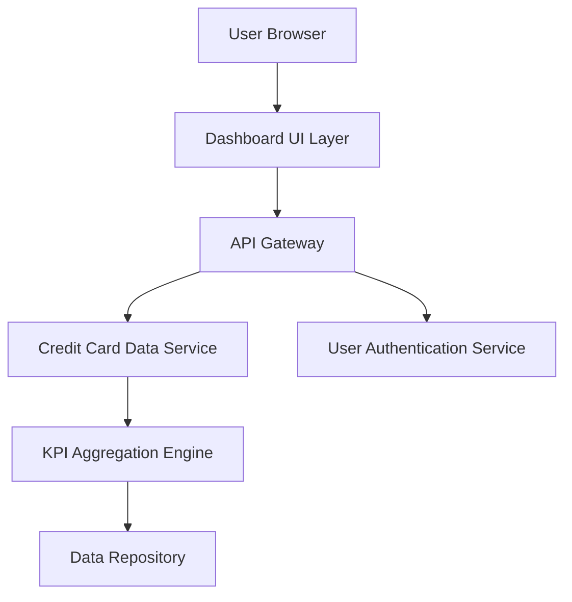

### 1. High-Level Design

**Summary:**  
This epic delivers a centralized dashboard that consolidates all credit card information and key performance indicators (KPIs) into a single responsive interface. Users can monitor monthly spend, total credit limit, available credit, and outstanding amounts across multiple credit cards, enabling quick assessment of their financial position and credit utilization.

**Component Flow:**

**Integration Points:**
- **Upstream:** User Authentication Service (for secure user access and session management)
- **Downstream:** Credit Card Data Service (retrieves card details, transaction data, and balances)
- **Internal:** KPI Aggregation Engine (calculates monthly spend, available credit, outstanding amounts)

**Key Assumptions:**
- Credit card data is available in near real-time from the Credit Card Data Service with a refresh interval of ≤5 seconds. Card data format follows a standardized JSON schema with fields for card_id, limit, balance, spend, and status.

**NFR Highlights:**  
Dashboard must load within 2 seconds for up to 10 credit cards; responsive design across desktop, tablet, and mobile; real-time KPI refresh on data changes.

### 2. Validation Report

**Requirements Coverage:**  
The design fully covers the epic's stated scope including dashboard interface, KPI displays (monthly spend, total credit limit, available credit, outstanding amount), responsive layout, and multi-card consolidated view. All NFRs regarding load time (2 seconds), responsive design, and real-time refresh are addressed through the architecture. Integration dependencies with credit card data service and authentication service are explicitly mapped in the component flow.