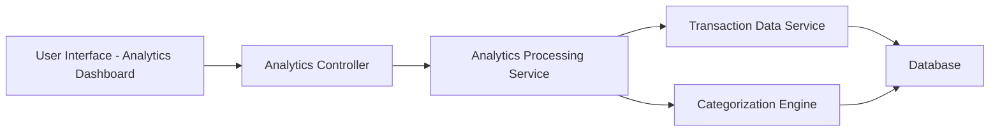

### 1. High-Level Design

**Summary:**  
This epic provides comprehensive spending analytics and visualization capabilities that help users understand their spending patterns across multiple categories (Food & Dining, Fuel, Shopping, Travel, Entertainment, Utilities, Healthcare, Education, Miscellaneous). The feature includes interactive visualizations, monthly spend trend analysis, and card-wise spend analysis, enabling users to identify patterns, track expenses over time, and make data-driven financial decisions.

**Component Flow:**

**Integration Points:**
- **Upstream:** Transaction data service (retrieves transaction history for analysis)
- **Upstream:** Categorization engine (classifies transactions into predefined spending categories)
- **Upstream:** Analytics processing service (performs trend calculations and aggregations)
- **Downstream:** Analytics UI (renders interactive charts, graphs, and visualizations)

**Key Assumptions:**
- Transactions are automatically categorized by the categorization engine; manual recategorization is out of scope.
- Historical transaction data for at least 12 months is available and accessible for trend analysis.

**NFR Highlights:**  
Analytics visualizations must render within 3 seconds, support interactive filtering and drill-down capabilities, handle minimum 12 months of historical transaction data.

### 2. Validation Report

**Requirements Coverage:**  
The design comprehensively covers the epic's scope including category-wise spending visualization, monthly spend trend analysis, card-wise spend analysis, interactive charts and graphs, transaction categorization, and spending pattern identification. The architecture integrates all required services (transaction data, categorization, analytics processing) and supports the specified NFRs for rendering performance, interactive capabilities, and historical data handling.