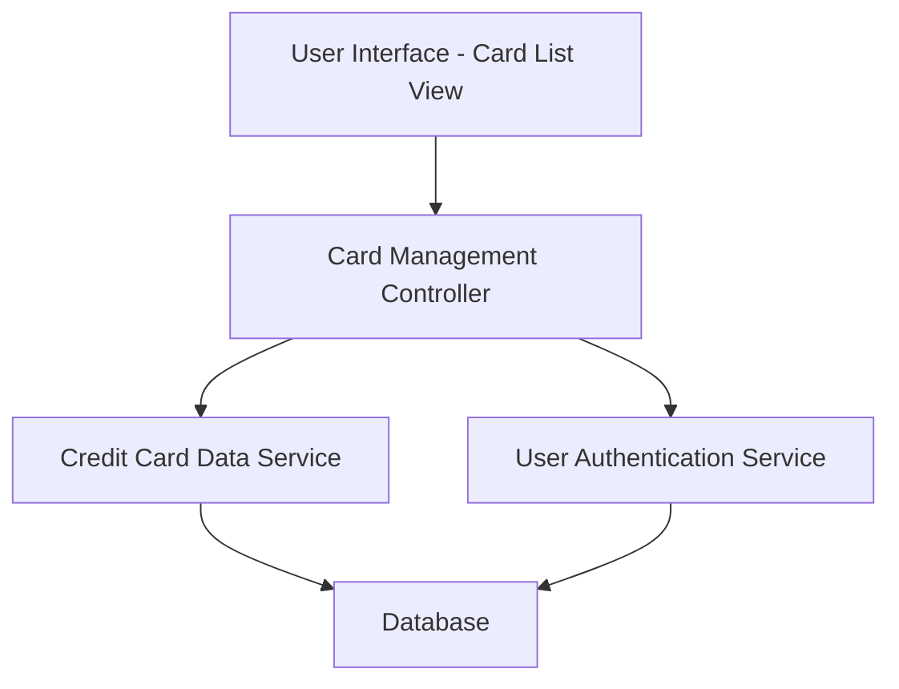

### 1. High-Level Design

**Summary:**  
This epic enables users to view and manage multiple credit cards within a single unified interface. Users can see all registered credit cards with individual card details, limits, and balances. The feature provides a comprehensive overview of each card's status, supporting comparison and tracking across the entire credit card portfolio in an intuitive manner.

**Component Flow:**

**Integration Points:**
- **Upstream:** Credit card data service (retrieves card information including details, limits, and balances)
- **Upstream:** User authentication service (ensures secure access to user's card portfolio)
- **Downstream:** Card list UI (displays organized view of all cards)

**Key Assumptions:**
- Card data is stored in a structured format with consistent schema across all card types.
- User authentication is handled by a separate service and provides secure session tokens for card data access.

**NFR Highlights:**  
System must support minimum 10 credit cards per user, card data retrieval must complete within 1 second, interface must be responsive across all device types.

### 2. Validation Report

**Requirements Coverage:**  
The design addresses all aspects of the epic's scope including multiple credit card display, individual card details view, card-wise balance tracking, card-wise credit limit display, and card organization interface. The architecture supports the NFRs for handling minimum 10 cards per user, 1-second data retrieval, and responsive interface design across devices.