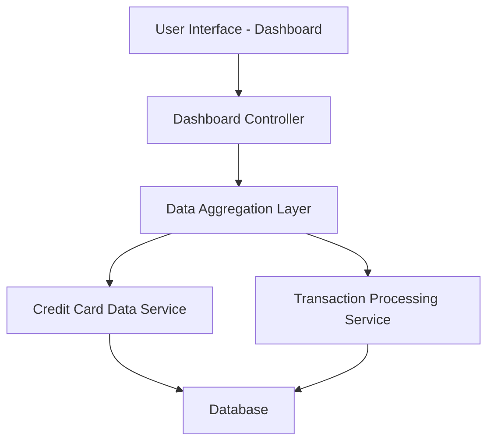

### 1. High-Level Design

**Summary:**  
This epic delivers a centralized dashboard that displays key performance indicators (KPIs) for the user's credit card portfolio. The dashboard consolidates critical financial metrics including monthly spend, total credit limit, available credit, and outstanding amounts across all credit cards, providing real-time visibility into the user's credit card financial health and enabling informed financial decision-making.

**Component Flow:**

**Integration Points:**
- **Upstream:** Credit card data service (retrieves card details, balances, and credit limits)
- **Upstream:** Transaction processing service (calculates monthly spend from transaction data)
- **Downstream:** Dashboard UI (consumes aggregated KPI data for display)

**Key Assumptions:**
- Card and transaction data are available in near real-time or with minimal latency from backend services.
- KPI calculations (monthly spend, available credit) are performed server-side and cached for performance.

**NFR Highlights:**  
Dashboard must load within 2 seconds, support responsive design for mobile and desktop devices, handle real-time data refresh for KPI metrics.

### 2. Validation Report

**Requirements Coverage:**  
The design fully covers the epic's stated scope including monthly spend display, total credit limit calculation, available credit tracking, outstanding amount monitoring, consolidated multi-card KPI view, and responsive dashboard layout. The component flow ensures integration with required data services, and the architecture supports the specified NFRs for load time and responsive design.