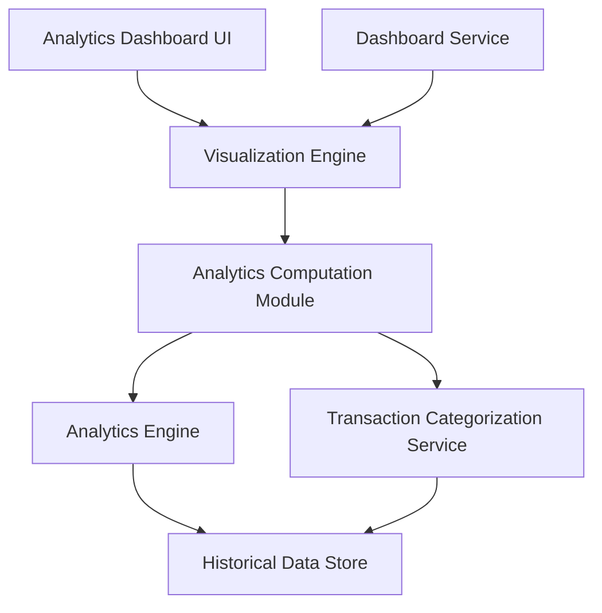

#### 1. High-Level Design

**Summary:** This epic provides interactive visualizations and analytical capabilities for users to understand spending patterns across 9 predefined categories (Food & Dining, Fuel, Shopping, Travel, Entertainment, Utilities, Healthcare, Education, Miscellaneous). The system delivers monthly trend analysis, card-wise breakdowns, and category-wise spending distributions with support for up to 24 months of historical data.

**Component Flow:**

**Integration Points:**
- **Upstream:** Transaction Categorization Service (maps transactions to spending categories)
- **Upstream:** Analytics Engine (aggregates and computes spending metrics)
- **Upstream:** Dashboard Service (data presentation and visualization rendering)
- **Internal:** Historical Data Store (maintains 24 months of transaction history)

**Key Assumptions:**
- Transaction categorization is performed asynchronously (batch or near-real-time) and stored pre-categorized for fast retrieval.
- Interactive filtering uses client-side state management with server-side API calls for data refresh without full page reload.

**NFR Highlights:** Analytics visualizations must render within 3 seconds; support interactive filtering without page reload; handle historical data for up to 24 months of transactions.

#### 2. Validation Report

**Requirements Coverage:** The design comprehensively covers all scope items including category-wise spending visualization, monthly spend trend analysis, card-wise spend breakdown, interactive charts and graphs, spending pattern identification, and multi-category support for 9 predefined categories. The architecture supports the NFRs for 3-second rendering, interactive filtering without page reload, and 24-month historical data retention. All stated dependencies (Transaction Categorization Service, Analytics Engine, Dashboard Service) are integrated into the component flow.