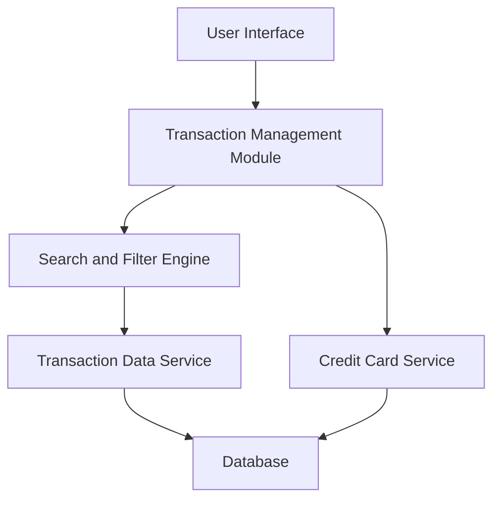

#### 1. High-Level Design

**Summary:** This epic delivers a transaction management interface that enables users to view, search, and filter credit card transactions across all registered cards. The system provides comprehensive transaction history with pagination support, helping users track spending, reconcile accounts, and identify unauthorized charges.

**Component Flow:**

**Integration Points:**
- **Upstream:** Transaction Data Service (retrieves historical and current transactions)
- **Upstream:** Credit Card Service (maps transactions to specific cards)
- **Downstream:** Database layer for transaction persistence and retrieval

**Key Assumptions:**
- Transaction data is pre-categorized and stored in a standardized format (e.g., JSON/XML) by the Transaction Data Service.
- Real-time transaction sync occurs at defined intervals (e.g., every 15 minutes) rather than true real-time streaming.

**NFR Highlights:** Transaction retrieval latency must be under 500ms; system must handle up to 10,000 transactions per user with pagination support for large datasets.

#### 2. Validation Report

**Requirements Coverage:** The design fully covers the epic's stated scope including transaction list view, multi-card aggregation, transaction details display, search functionality, filtering capabilities, and date range selection. The component architecture supports the NFRs for pagination, volume handling (10,000 transactions), and latency requirements (sub-500ms retrieval). Integration with Transaction Data Service and Credit Card Service satisfies the stated dependencies.