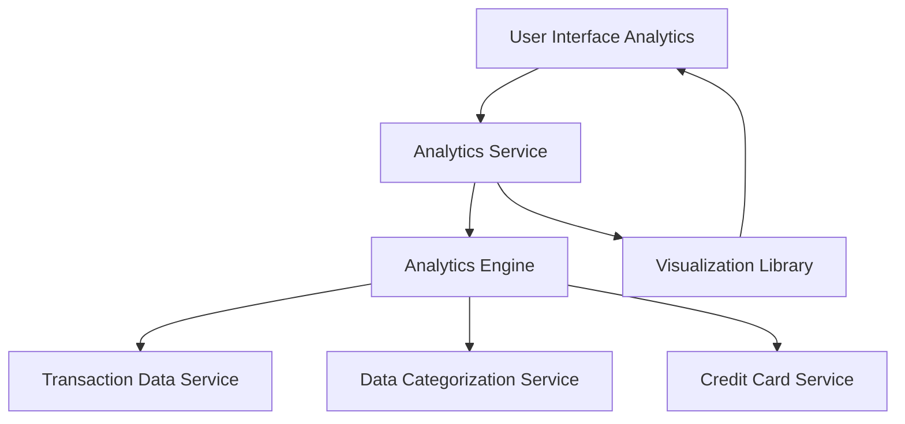

#### 1. High-Level Design

- **Summary:** This epic provides interactive data visualization and analytical capabilities to help users understand spending patterns across categories and time periods. The system categorizes transactions into predefined categories (Food & Dining, Fuel, Shopping, Travel, Entertainment, Utilities, Healthcare, Education, Miscellaneous) and presents monthly trends and card-wise breakdowns through intuitive charts and graphs.

- **Component Flow:**

- **Integration Points:** 
  - **Upstream:** Transaction data service (provides raw transaction data), Data categorization service (categorizes transactions), Analytics engine (processes and aggregates data), Credit card service (provides card details), Visualization library (renders charts)
  - **Downstream:** User interface analytics (displays interactive visualizations)

- **Key Assumptions:** 
  - Transaction data includes sufficient metadata for accurate categorization into predefined categories
  - Visualization library supports responsive rendering and dynamic filtering capabilities

- **NFR Highlights:** Interactive visualizations must render within 3 seconds; System must support dynamic filtering and drill-down capabilities; Charts must be responsive and mobile-friendly; Analytics must accurately aggregate and categorize transaction data

- **Data Flow:** User accesses analytics interface → Analytics Service requests transaction data from Transaction Data Service → Data Categorization Service categorizes transactions into predefined categories (Food & Dining, Fuel, Shopping, Travel, Entertainment, Utilities, Healthcare, Education, Miscellaneous) → Analytics Engine aggregates data by category, time period, and card → Processed data is formatted for visualization → Visualization Library renders interactive charts showing monthly trends and card-wise breakdowns → User Interface displays visualizations with dynamic filtering and drill-down capabilities

#### 2. Validation Report

- **Requirements Coverage:** The design fully addresses all scope elements including category-wise spending analysis, monthly spend trends visualization, card-wise spend analysis, interactive charts and graphs, and spending categorization across all specified categories (Food & Dining, Fuel, Shopping, Travel, Entertainment, Utilities, Healthcare, Education, Miscellaneous). All dependencies (Transaction data service, Analytics engine, Data categorization service, Visualization library, Credit card service) are incorporated into the architecture. The design respects out-of-scope boundaries (no real bank integration, predictive analytics, budget recommendations, alerts/notifications, or export functionality). NFRs for 3-second rendering, dynamic filtering, responsive design, and accurate aggregation are addressed through the dedicated analytics engine, categorization service, and visualization library components.