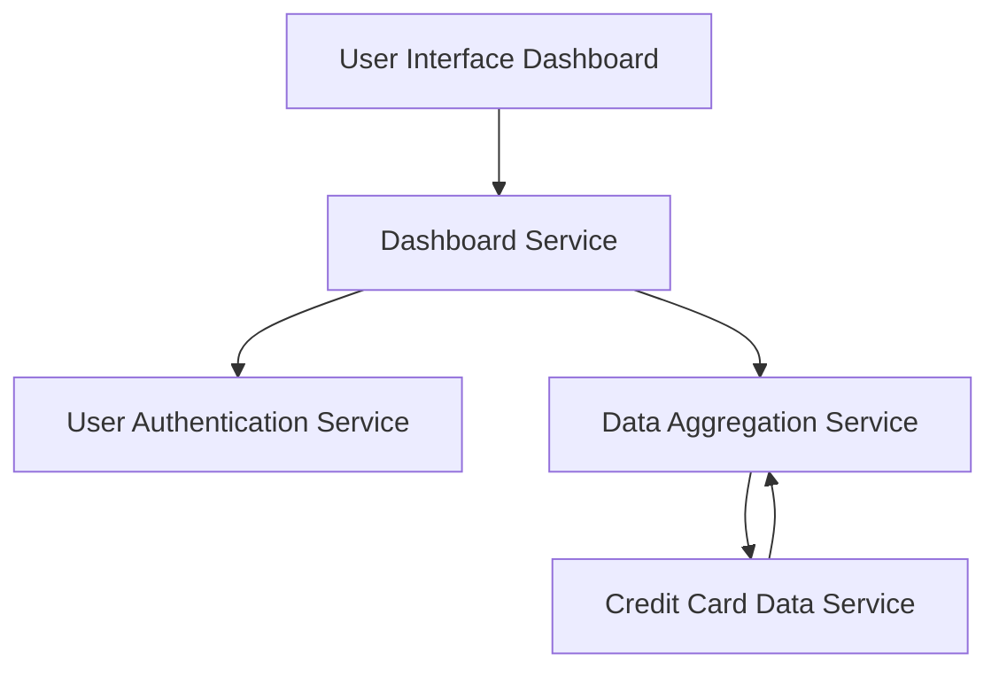

#### 1. High-Level Design

- **Summary:** This epic delivers a consolidated dashboard that displays key performance indicators for a user's entire credit card portfolio. The dashboard aggregates data from multiple credit cards to show monthly spend, total credit limit, available credit, and outstanding amounts, providing real-time visibility into overall credit card financial health.

- **Component Flow:**

- **Integration Points:** 
  - **Upstream:** Credit card data service (provides card details and balances), User authentication service (validates user access), Data aggregation service (consolidates multi-card data)
  - **Downstream:** User interface dashboard (displays KPIs and consolidated view)

- **Key Assumptions:** 
  - Credit card data service provides near real-time data updates for KPIs
  - Data aggregation service can handle concurrent requests from multiple users efficiently

- **NFR Highlights:** System must support responsive layouts across devices; Dashboard must load within 2 seconds; Real-time data refresh for KPIs; Support for concurrent users viewing dashboards

- **Data Flow:** User logs in via User Authentication Service → Dashboard Service requests user's credit card portfolio → Data Aggregation Service fetches data from Credit Card Data Service for all cards → Service calculates KPIs (monthly spend, total credit limit, available credit, outstanding amounts) → Aggregated metrics are returned to Dashboard Service → User Interface Dashboard displays consolidated KPIs with real-time refresh capability

#### 2. Validation Report

- **Requirements Coverage:** The design comprehensively addresses all scope items including dashboard KPI display, monthly spend tracking, total credit limit calculation, available credit display, outstanding amount tracking, multiple credit card view, and consolidated interface. All dependencies (Credit card data service, User authentication service, Data aggregation service) are integrated into the architecture. The design excludes out-of-scope items (real bank integration, card payments, fund transfers, loans, payment gateway integration). NFRs for responsive layouts, 2-second load time, real-time refresh, and concurrent user support are addressed through the dedicated data aggregation service and efficient dashboard service architecture.