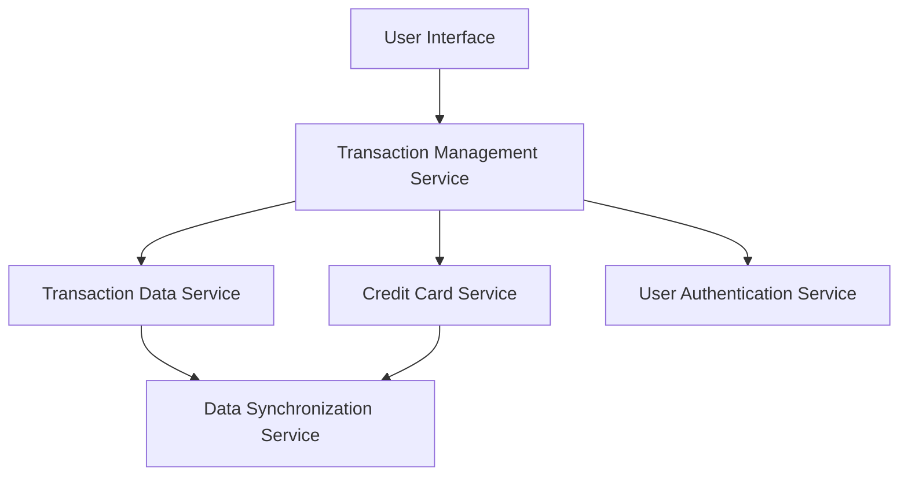

#### 1. High-Level Design

- **Summary:** This epic implements a comprehensive transaction management system that aggregates and displays credit card transactions from multiple cards in a unified interface. Users can view, search, and filter transactions to monitor spending behavior, identify unauthorized activities, and maintain accurate records across all their credit cards.

- **Component Flow:**

- **Integration Points:** 
  - **Upstream:** Transaction data service (provides transaction records), Credit card service (provides card details), User authentication service (validates user identity), Data synchronization service (ensures data consistency)
  - **Downstream:** User interface layer (displays transaction data)

- **Key Assumptions:** 
  - Transaction data is provided in a standardized format by the transaction data service
  - Real-time synchronization is handled by the data synchronization service with acceptable latency

- **NFR Highlights:** System must handle high transaction volumes efficiently; Transaction data must be displayed with minimal latency; Responsive design for mobile and desktop viewing; Data accuracy and consistency across all cards

- **Data Flow:** User authenticates → Transaction Management Service retrieves user's credit cards from Credit Card Service → Service fetches transactions from Transaction Data Service for all cards → Data Synchronization Service ensures consistency → Aggregated transactions are filtered/searched based on user criteria → Results displayed in User Interface with search and filter capabilities

#### 2. Validation Report

- **Requirements Coverage:** The design fully covers the epic's stated scope including transaction listing, viewing, multi-card aggregation, search and filter capabilities, and transaction history access. All dependencies (Transaction data service, Credit card service, User authentication service, Data synchronization service) are incorporated into the architecture. The design respects the out-of-scope items (no real bank integration, payments, fund transfers, or payment gateway integration). NFRs for high volume handling, minimal latency, and responsive design are addressed through the modular service architecture and dedicated data synchronization component.