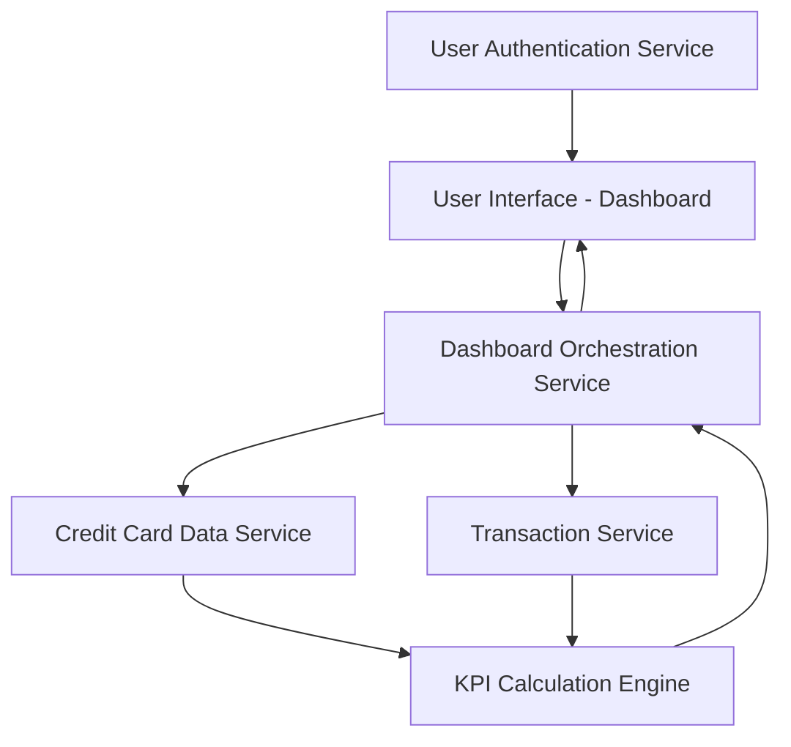

#### 1. High-Level Design

- **Summary**: This epic delivers a centralized dashboard that displays critical financial KPIs in real-time, including monthly spending, total credit limit across all cards, available credit, and outstanding amounts. The dashboard provides a responsive, unified interface that aggregates data from multiple credit cards and presents it through interactive widgets and visualizations, enabling users to monitor their financial health at a glance.

- **Component Flow**:

- **Integration Points**:
  - **Upstream**: Credit Card Data Service (retrieves card balances and credit limits)
  - **Upstream**: Transaction Service (calculates monthly spend and outstanding amounts)
  - **Upstream**: User Authentication Service (ensures secure access to dashboard)
  - **Internal**: Dashboard Orchestration Service (coordinates data retrieval and KPI updates)
  - **Internal**: KPI Calculation Engine (performs financial calculations for metrics)

- **Key Assumptions**: 
  - "Monthly spending" is calculated as the sum of all transactions posted in the current calendar month; partial month calculations are based on month-to-date data.
  - Real-time data refresh occurs at configurable intervals (e.g., every 5 minutes) rather than true real-time streaming; user can manually trigger refresh.

- **NFR Highlights**: Dashboard must load within 2 seconds, support responsive layouts across desktop, tablet, and mobile devices, handle real-time data refresh for KPI updates, and ensure data accuracy for all financial calculations.

- **Data Flow**: User logs in via User Authentication Service → Dashboard Orchestration Service is invoked → Service retrieves all user's credit cards from Credit Card Data Service → For each card, credit limits and current balances are fetched → Transaction Service provides monthly spending and outstanding amounts → KPI Calculation Engine aggregates data (total credit limit, available credit, total outstanding, monthly spend) → Dashboard Orchestration Service formats KPIs for display → Responsive dashboard UI renders KPI widgets and visualizations → Dashboard supports periodic auto-refresh and manual refresh for real-time updates.

#### 2. Validation Report

- **Requirements Coverage**: The design fully satisfies the epic's scope including monthly spend display, total credit limit calculation, available credit tracking, outstanding amount monitoring, dashboard layout and responsive design, and KPI widgets and visualizations. All NFRs are addressed: 2-second load time through efficient orchestration and caching, responsive layouts via adaptive UI components, real-time data refresh capability through the Dashboard Orchestration Service, and data accuracy ensured by the dedicated KPI Calculation Engine. The architecture integrates all required upstream services (Credit Card Data Service, Transaction Service, User Authentication Service) and provides a clear separation between data retrieval, calculation, and presentation layers.