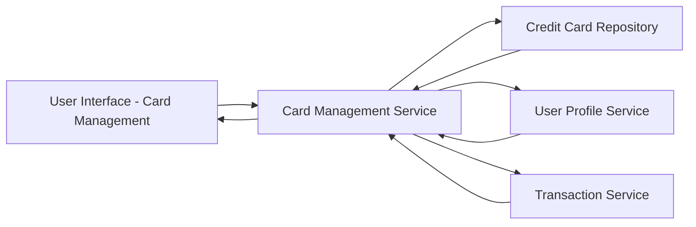

#### 1. High-Level Design

- **Summary**: This epic provides a unified interface for users to manage and monitor multiple credit cards (minimum 10 cards per user). Users can view all cards in a consolidated list, access individual card details (credit limits, balances, masked card numbers), perform card-wise spend analysis, and filter/select cards for detailed monitoring. The system aggregates data from multiple sources to provide a comprehensive portfolio view.

- **Component Flow**:

- **Integration Points**:
  - **Upstream**: Credit Card Repository (stores and retrieves card information with secure storage)
  - **Upstream**: User Profile Service (associates cards with user accounts)
  - **Upstream**: Transaction Service (provides card-specific spending data)
  - **Internal**: Card Management Service (orchestrates card data aggregation and presentation)

- **Key Assumptions**: 
  - Card numbers are masked using a standard format (e.g., XXXX-XXXX-XXXX-1234) for security; full card numbers are never displayed in the UI.
  - Card data is retrieved on-demand when the user accesses the multi-card view; no real-time push notifications for card balance changes.

- **NFR Highlights**: System must support minimum 10 credit cards per user, card data retrieval must complete within 3 seconds, ensure secure storage and display of card information with masked card numbers, and support concurrent viewing of multiple cards.

- **Data Flow**: User accesses multi-card management interface → Card Management Service authenticates user via User Profile Service → Service queries Credit Card Repository for all cards associated with user → For each card, Transaction Service is called to retrieve current balances and spending data → Card Management Service aggregates and formats data with masked card numbers → Consolidated card list with individual card details is displayed to user → User can select/filter cards for detailed spend analysis.

#### 2. Validation Report

- **Requirements Coverage**: The design comprehensively addresses the epic's scope including multiple credit card display, card details view, card-wise spend breakdown, individual card credit limit and balance tracking, card selection and filtering, and card list management. All NFRs are met: support for minimum 10 cards per user, 3-second data retrieval performance, secure storage with masked card numbers, and concurrent multi-card viewing. The architecture clearly separates concerns with dedicated services for card repository, user profile management, and transaction data, ensuring scalability and maintainability.