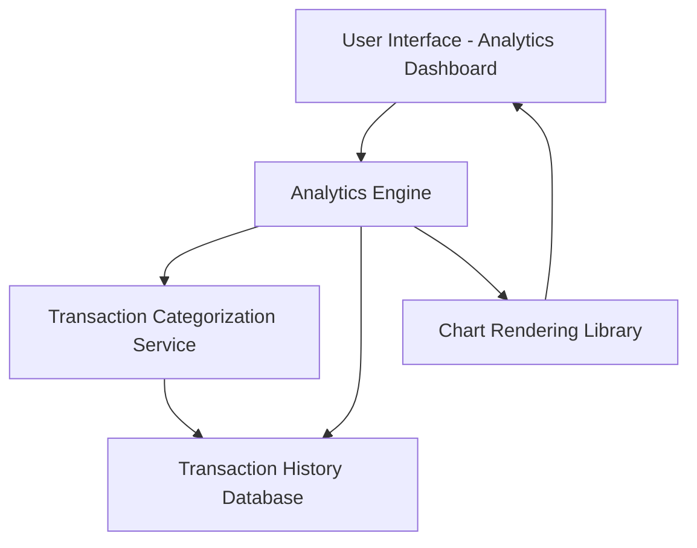

#### 1. High-Level Design

- **Summary**: This epic delivers an analytics module that provides users with interactive visualizations of their credit card spending patterns across nine predefined categories (Food & Dining, Fuel, Shopping, Travel, Entertainment, Utilities, Healthcare, Education, Miscellaneous). The system analyzes up to 12 months of transaction history to generate monthly spend trends and category-wise breakdowns, enabling data-driven financial decision-making.

- **Component Flow**:

- **Integration Points**:
  - **Upstream**: Transaction Categorization Service (classifies transactions into predefined categories)
  - **Upstream**: Transaction History Database (provides historical transaction data)
  - **Internal**: Analytics Engine (processes data and generates insights)
  - **Internal**: Chart Rendering Library (renders visualizations)

- **Key Assumptions**: 
  - Transaction categorization is performed automatically by the Transaction Categorization Service with 95% accuracy; manual recategorization is out of scope.
  - Monthly spend trends are calculated based on transaction posting dates, not transaction authorization dates.

- **NFR Highlights**: Analytics visualizations must render within 1.5 seconds, support interactive charts with smooth transitions, handle up to 12 months of transaction history, and ensure 95% transaction categorization accuracy.

- **Data Flow**: User requests analytics view → Analytics Engine queries Transaction History Database for transactions → Transaction Categorization Service classifies transactions into nine categories → Analytics Engine aggregates spending by category and time period → Processed data is sent to Chart Rendering Library → Interactive visualizations are displayed to user with category breakdowns and monthly trends.

#### 2. Validation Report

- **Requirements Coverage**: The design fully covers the epic's stated scope including category-wise spending visualization, monthly spend trend charts, interactive analytics dashboards, spending breakdown by category, nine predefined spending categories, and data filtering and drill-down capabilities. All NFRs regarding rendering performance (1.5 seconds), 12-month history handling, and 95% categorization accuracy are addressed through the component architecture. Integration with Transaction Categorization Service and Transaction History Database ensures accurate data sourcing and processing.