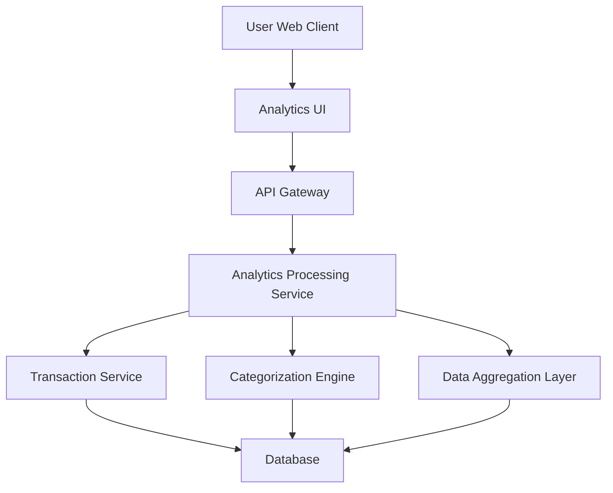

#### 1. High-Level Design

- **Summary:** This epic delivers interactive visualizations and analytics capabilities that enable users to understand spending patterns across nine predefined categories (Food & Dining, Fuel, Shopping, Travel, Entertainment, Utilities, Healthcare, Education, Miscellaneous) and analyze monthly spend trends over time. The solution provides data-driven insights through charts, graphs, and drill-down capabilities to support improved financial decision-making.

- **Component Flow:**

- **Integration Points:**
  - **Upstream:** Transaction Service (provides historical transaction data for up to 12 months)
  - **Downstream:** Categorization Engine (automatically categorizes transactions into predefined spending categories), Data Aggregation Layer (aggregates and summarizes spending data for visualization)
  - **Data Store:** Transaction database with indexed category and timestamp fields for efficient querying

- **Key Assumptions:**
  - Transactions are automatically categorized by the Categorization Engine using merchant codes and transaction descriptions; manual recategorization by users is not included in this epic
  - Monthly spend trends display data for the most recent 12 months by default, with interactive filtering to adjust the time range

- **NFR Highlights:** Analytics must process and display data for up to 12 months of transaction history, visualizations must render within 3 seconds, must support interactive filtering and drill-down capabilities, must handle large transaction datasets efficiently

- **Data Flow:** User accesses the Analytics UI and selects desired time periods or categories. The Analytics Processing Service retrieves transaction data from the Transaction Service, which is then processed by the Categorization Engine to assign categories. The Data Aggregation Layer summarizes spending by category and time period. Aggregated data is returned to the UI and rendered as interactive charts and graphs (category-wise breakdowns, monthly trend lines). Users can filter by date range, drill down into specific categories, and view detailed transaction lists supporting each aggregated metric.

#### 2. Validation Report

- **Requirements Coverage:** The design fully addresses all scope elements including category-wise spending visualization, monthly spend trends, interactive charts and graphs, spending pattern analysis, and transaction categorization across all nine specified categories (Food & Dining, Fuel, Shopping, Travel, Entertainment, Utilities, Healthcare, Education, Miscellaneous). Performance NFRs (12-month history support, 3-second render time, interactive filtering, efficient large dataset handling) are met through indexed database queries, aggregation layers, and optimized visualization libraries. The design appropriately excludes out-of-scope features (real bank integration, predictive analytics, budget recommendations, payment scheduling, third-party integrations) as defined in the epic.