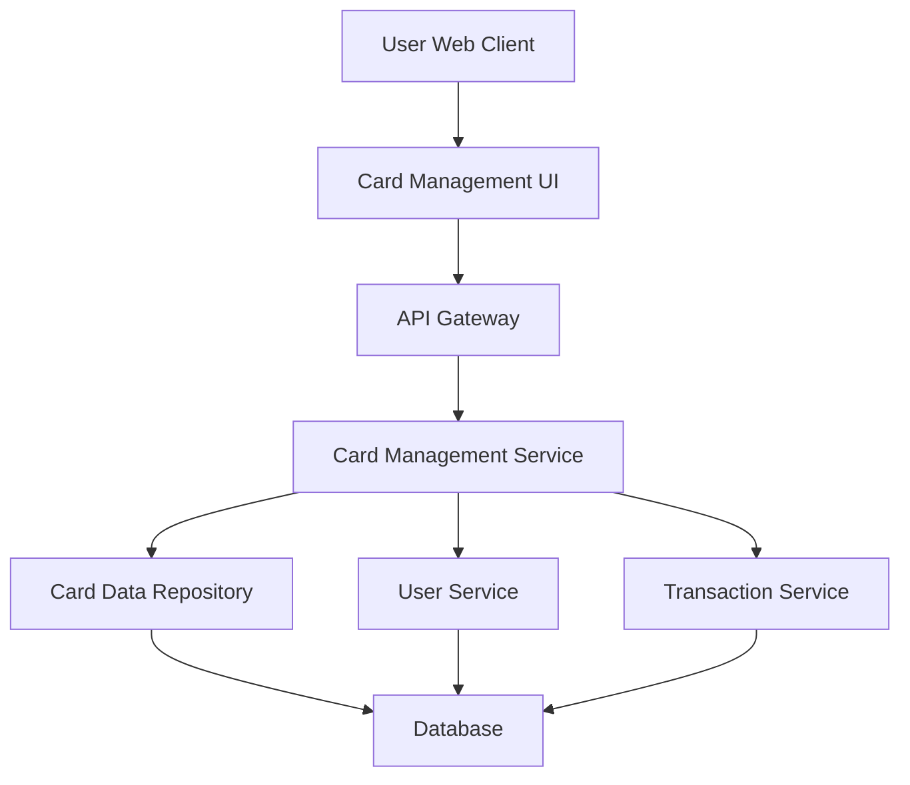

#### 1. High-Level Design

- **Summary:** This epic provides a unified interface for users to manage and monitor multiple credit cards (minimum 10 per user). Users can view their complete card portfolio, access individual card details (credit limits, balances, utilization), perform card-wise spend analysis, and compare usage patterns across cards. The solution enables comprehensive tracking and optimization of credit card utilization.

- **Component Flow:**

- **Integration Points:**
  - **Upstream:** User Service (validates card ownership and user permissions)
  - **Downstream:** Card Data Repository (stores and retrieves credit card information), Transaction Service (provides card-specific spending data and transaction history)
  - **Data Store:** Secure database with encrypted storage for sensitive card information

- **Key Assumptions:**
  - Card-wise spend analysis defaults to current month unless user selects a different time period
  - Card utilization percentage is calculated as (current balance / credit limit) × 100 for each card

- **NFR Highlights:** System must support minimum 10 credit cards per user, card data must be securely stored and transmitted (encryption at rest and in transit), interface must render card list within 1 second, must support concurrent access by multiple users

- **Data Flow:** User accesses the Card Management UI, which requests card portfolio data through the API Gateway. The Card Management Service validates user ownership via User Service, then retrieves all cards associated with the user from the Card Data Repository. For each card, the service fetches spend data from the Transaction Service. Card details (limits, balances, utilization) and card-wise spend analysis are aggregated and returned to the UI. Users can filter, select, and drill down into individual card details for deeper analysis.

#### 2. Validation Report

- **Requirements Coverage:** The design comprehensively covers all scope items including multiple credit card display, card-wise spend analysis, individual card details view, card utilization tracking, card selection and filtering, and card portfolio overview. Security NFRs are addressed through encrypted storage and transmission. Performance requirements (1-second render time, concurrent access) are met through efficient data retrieval and caching strategies. The design correctly excludes out-of-scope elements (real bank integration, payments, transfers, new card applications) as specified in the epic.