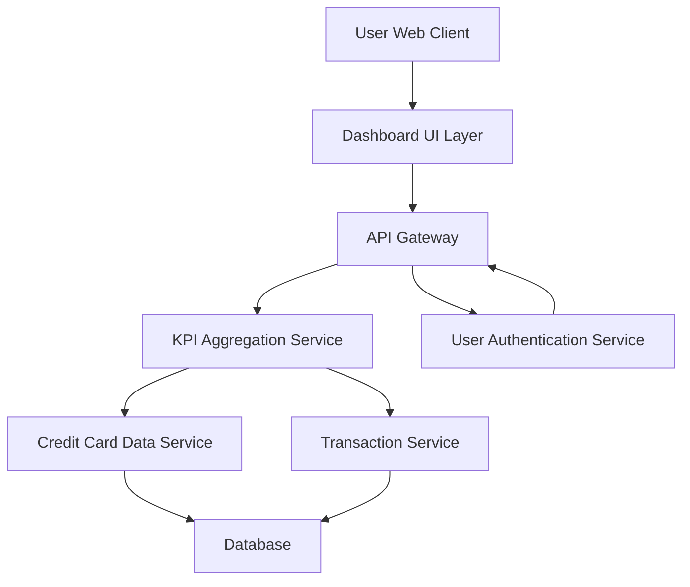

#### 1. High-Level Design

- **Summary:** This epic delivers a responsive dashboard interface that consolidates and displays critical credit card portfolio KPIs including monthly spend, total credit limit, available credit, and outstanding amounts. The solution provides real-time visibility into the user's overall credit card financial health through an intuitive, at-a-glance view that supports informed financial decision-making.

- **Component Flow:**

- **Integration Points:**
  - **Upstream:** User Authentication Service (for secure access and user identity validation)
  - **Downstream:** Credit Card Data Service (retrieves card balances, limits, and account information), Transaction Service (calculates monthly spend from transaction history)
  - **Data Store:** Centralized database for credit card and transaction data persistence

- **Key Assumptions:**
  - Monthly spend is calculated based on the current calendar month (start to current date) unless user preferences specify a custom billing cycle
  - Real-time data refresh is achieved through polling mechanism with configurable intervals (default: 30 seconds) rather than WebSocket push notifications

- **NFR Highlights:** Dashboard must load within 2 seconds, must be responsive across desktop and mobile devices, must support real-time data refresh, must handle multiple concurrent users

- **Data Flow:** User authenticates through the Authentication Service, then the Dashboard UI requests KPI data via API Gateway. The KPI Aggregation Service fetches card balances and limits from Credit Card Data Service and monthly spend from Transaction Service. Aggregated KPIs (monthly spend, total credit limit, available credit, outstanding amount) are calculated and returned to the UI for visualization. Data is refreshed periodically to maintain real-time accuracy.

#### 2. Validation Report

- **Requirements Coverage:** The design fully covers the epic's stated scope including monthly spend display, total credit limit aggregation, available credit calculation, outstanding amount tracking, responsive dashboard layout, and KPI visualization components. All NFRs (2-second load time, responsive design, real-time refresh, concurrent user support) are addressed through appropriate architectural patterns (API Gateway for scalability, dedicated aggregation service for performance, responsive UI framework). The design explicitly excludes out-of-scope items (real bank integration, payments, transfers) as specified in the epic.