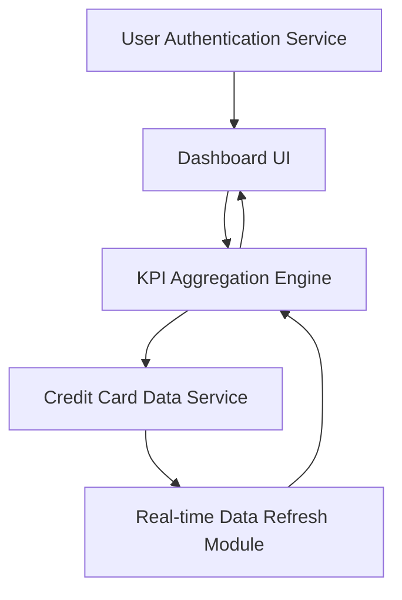

#### 1. High-Level Design

- **Summary:** This epic creates a consolidated dashboard that displays key performance indicators (KPIs) across all user credit cards in a unified interface. The dashboard provides real-time visibility into monthly spend, total credit limit, available credit, and outstanding amounts to support informed financial decision-making.

- **Component Flow:**

- **Integration Points:** 
  - **Upstream:** Credit card data service (for fetching card details and transaction data)
  - **Upstream:** User authentication service (for secure access control)
  - **Downstream:** Dashboard UI for presenting aggregated KPIs and metrics

- **Key Assumptions:** 
  - Credit card data service provides near real-time data updates to support the 2-second dashboard load requirement
  - KPI calculations (available credit, outstanding amounts) follow standard financial formulas and are computed server-side

- **NFR Highlights:** Dashboard must load within 2 seconds, system must support real-time data refresh, UI must be responsive across desktop, tablet, and mobile devices

#### 2. Validation Report

- **Requirements Coverage:** The design fully addresses the epic scope including dashboard KPI display, monthly spend tracking, total credit limit aggregation, available credit calculation, outstanding amount tracking, and responsive layout implementation. The architecture incorporates a dedicated KPI aggregation engine and real-time data refresh module to meet the stringent NFRs for 2-second load time, real-time data refresh capability, and cross-device responsiveness.