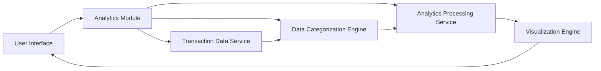

#### 1. High-Level Design

- **Summary:** This epic provides interactive analytics and visualization capabilities to help users understand spending patterns across predefined categories (Food & Dining, Fuel, Shopping, Travel, Entertainment, Utilities, Healthcare, Education, Miscellaneous). The feature includes monthly trend analysis and pattern identification to support data-driven financial decisions.

- **Component Flow:**

- **Integration Points:** 
  - **Upstream:** Transaction data service (for historical transaction records)
  - **Upstream:** Data categorization engine (for automatic transaction categorization)
  - **Upstream:** Analytics processing service (for trend calculations and pattern analysis)
  - **Downstream:** Visualization engine for rendering interactive charts and graphs

- **Key Assumptions:** 
  - Transactions are automatically categorized by the data categorization engine with acceptable accuracy
  - Historical transaction data is retained for at least 12 months to support meaningful trend analysis

- **NFR Highlights:** Analytics visualizations must render within 3 seconds, system must support processing of minimum 1000 transactions per user, charts must be interactive and responsive across all devices

#### 2. Validation Report

- **Requirements Coverage:** The design comprehensively addresses all scope elements including category-wise spending visualization, interactive charts/graphs, monthly spend trend analysis, transaction categorization, spending pattern identification, and multi-category filtering. The architecture supports the specified NFRs for performance (3-second rendering), scale (1000+ transactions), and cross-device responsiveness through a dedicated visualization engine and analytics processing service.