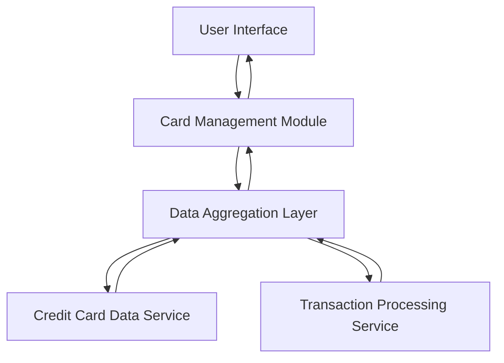

#### 1. High-Level Design

- **Summary:** This epic delivers a multi-card management interface that allows users to view, navigate, and analyze multiple credit cards from a single application. Users can access card-specific details, perform card-wise spend analysis, and compare performance metrics across their credit card portfolio.

- **Component Flow:**

- **Integration Points:** 
  - **Upstream:** Credit card data service (for retrieving card information and details)
  - **Upstream:** Transaction processing service (for card-specific transaction history)
  - **Downstream:** User interface layer for rendering card views and analytics

- **Key Assumptions:** 
  - Card data is available in a standardized format from the credit card data service
  - Transaction history is pre-categorized and available through the transaction processing service

- **NFR Highlights:** System must support minimum 10 credit cards per user, card data retrieval must complete within 1 second, interface must maintain performance with increasing number of cards

#### 2. Validation Report

- **Requirements Coverage:** The design fully covers the epic's scope including multiple credit card display, card-wise spend analysis, individual card detail views, card selection/navigation, and monthly spend trends per card. The component architecture supports the NFR requirements for performance (1-second retrieval), scalability (10+ cards), and maintains separation of concerns between UI, business logic, and data services.