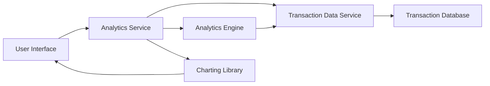

#### 1. High-Level Design

- **Summary**: This epic delivers interactive spending analytics and visualizations that help users understand their spending patterns through category-wise breakdowns (Food & Dining, Fuel, Shopping, Travel, Entertainment, Utilities, Healthcare, Education, Miscellaneous) and monthly trend analysis. The feature supports historical data analysis up to 12 months and provides responsive, touch-enabled interactive charts.

- **Component Flow**:

- **Integration Points**: 
  - **Upstream**: Transaction data service (provides categorized transaction history)
  - **Upstream**: Analytics engine (performs data aggregation, trend calculation, and pattern identification)
  - **Downstream**: Charting library (renders interactive visualizations in the user interface)

- **Key Assumptions**: 
  - Transactions are pre-categorized by the transaction data service using predefined rules or ML models
  - Analytics engine pre-aggregates monthly spending data to ensure sub-1-second visualization rendering

- **NFR Highlights**: Analytics processing must handle minimum 1000 transactions per user per month; visualization rendering time under 1 second; support for 12 months historical data; interactive charts must be responsive and touch-enabled

- **Data Flow**: User requests spending analytics → Analytics Service queries Transaction Data Service for user's transaction history → Transaction Data Service retrieves categorized transactions from Transaction Database (up to 12 months, minimum 1000 transactions/month) → Analytics Engine processes transaction data to calculate category-wise spending totals and monthly trend patterns → Analytics Service receives aggregated spending data by category and time period → Service formats data for visualization → Charting Library renders interactive, responsive charts (category breakdowns, trend lines, spending patterns) → User Interface displays visualizations with touch-enabled interactivity → User explores spending insights through visual analytics to identify patterns and make informed financial decisions

#### 2. Validation Report

- **Requirements Coverage**: The design fully satisfies the epic's scope including category-wise spending visualization across all 9 predefined categories, monthly spend trend charts, interactive analytics dashboards, spending pattern identification, multi-category breakdown, and transaction categorization display. The architecture meets all NFRs with analytics engine capable of processing 1000+ transactions per user per month, sub-1-second visualization rendering through pre-aggregation strategies, 12-month historical data support via transaction database, and responsive touch-enabled charts through modern charting library integration. All integration dependencies are addressed including transaction data service, analytics engine, and charting library components.