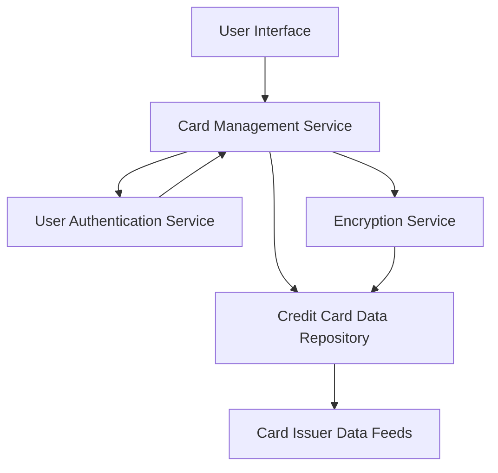

#### 1. High-Level Design

- **Summary**: This epic enables users to manage and view multiple credit cards (minimum 10 per user) within a single unified interface. Users can access detailed card-specific information including spending, credit limits, available credit, and outstanding balances for each card, with comparison capabilities across the entire portfolio.

- **Component Flow**:

- **Integration Points**: 
  - **Upstream**: User authentication service (secure access control and user identity verification)
  - **Upstream**: Credit card data repository (centralized storage of card information)
  - **Upstream**: Card issuer data feeds (real-time card information from financial institutions)
  - **Cross-cutting**: Encryption service (data encryption at rest and in transit)

- **Key Assumptions**: 
  - Card data is synchronized from card issuer feeds at regular intervals (assumed hourly or event-driven)
  - User owns card data access rights validated through authentication service before displaying card details

- **NFR Highlights**: System must support minimum 10 credit cards per user; card data retrieval latency under 500ms; secure storage and display with data encryption at rest and in transit

- **Data Flow**: User authenticates → Authentication Service validates credentials → User requests card portfolio view → Card Management Service retrieves user's card list from Credit Card Data Repository → Repository fetches latest data from Card Issuer Data Feeds → Encryption Service decrypts card details for display → Card Management Service aggregates card-specific metrics (spending, limits, available credit, outstanding balances) for each card → Service returns formatted card portfolio data → User Interface displays all cards with individual and comparative views, enabling users to analyze and compare multiple cards simultaneously

#### 2. Validation Report

- **Requirements Coverage**: The design comprehensively addresses the epic's scope including multiple card display (supporting 10+ cards), card-wise spend analysis, individual card credit limit view, per-card available credit tracking, card-specific outstanding balance display, and card comparison capability. The architecture satisfies all NFRs with sub-500ms retrieval latency through optimized data repository queries, secure storage and encryption services for card data protection, and support for minimum 10 cards per user. All integration dependencies are incorporated including user authentication service, credit card data repository, and card issuer data feeds.