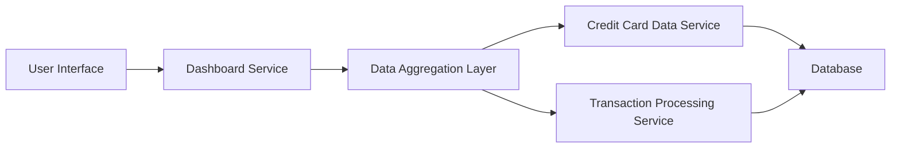

#### 1. High-Level Design

- **Summary**: This epic delivers a consolidated credit card dashboard that displays key performance indicators (KPIs) including monthly spend, total credit limit, available credit, and outstanding amounts. The dashboard provides real-time visibility into the user's credit card portfolio financial health through a responsive, modern interface accessible across all device types.

- **Component Flow**:

- **Integration Points**: 
  - **Upstream**: Credit card data service (retrieves card details, balances, credit limits)
  - **Upstream**: Transaction processing service (calculates monthly spend and outstanding amounts)
  - **Downstream**: User interface layer (responsive web/mobile clients)

- **Key Assumptions**: 
  - Credit card data is refreshed in near real-time (within seconds) from upstream services
  - KPI calculations are performed server-side with cached results to meet the 2-second page load requirement

- **NFR Highlights**: Dashboard must be responsive across all device types; page load time under 2 seconds; real-time data refresh capability; support for concurrent users

- **Data Flow**: User requests dashboard → Dashboard Service queries Data Aggregation Layer → Aggregation Layer fetches card details from Credit Card Data Service and transaction summaries from Transaction Processing Service → Services retrieve data from Database → Aggregated KPIs (monthly spend, total credit limit, available credit, outstanding amounts) are calculated and returned → Dashboard Service formats and sends data to User Interface → User views consolidated KPI dashboard with real-time metrics

#### 2. Validation Report

- **Requirements Coverage**: The design fully covers the epic's stated scope including monthly spend display, total credit limit tracking, available credit calculation, outstanding amount monitoring, responsive dashboard layout, and multi-card consolidated view. The component architecture supports all specified NFRs including sub-2-second page load times through data aggregation caching, responsive design across devices, real-time refresh capability, and concurrent user support. All integration dependencies with credit card data service and transaction processing service are addressed in the architecture.