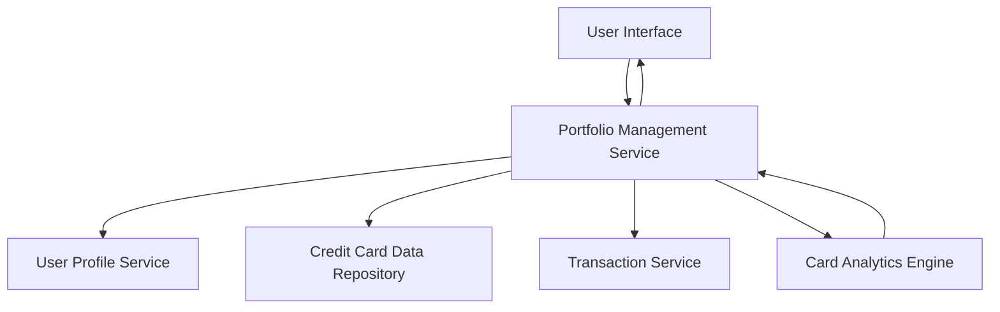

#### 1. High-Level Design

- **Summary:** This epic enables users to manage and view multiple credit cards within a unified interface, providing comprehensive visibility into their entire credit card portfolio. Users can view all cards with relevant details (card type, credit limits, current balances, card-specific information), perform card-wise spend analysis, and drill down into individual card performance and usage patterns. The interface supports easy navigation between cards and displays card-specific metrics in an intuitive format to help users optimize card utilization.

- **Component Flow:**

- **Integration Points:**
  - **Upstream:** Credit Card data repository (stores and provides card details, limits, balances, and card-specific information)
  - **Upstream:** User profile service (maps card ownership to users)
  - **Upstream:** Transaction service (provides card-specific spending data for analysis)

- **Key Assumptions:**
  - Card ownership mapping is maintained by the User Profile Service; each card is uniquely identifiable and associated with a specific user account.
  - Card-wise spend analysis aggregates transactions by card identifier; the Transaction Service provides transactions tagged with card-specific identifiers.

- **NFR Highlights:** System must support viewing and managing multiple credit cards per user without performance degradation; card data must be securely stored and transmitted; interface must maintain responsiveness with increasing number of cards.

- **Data Flow:** The User Interface sends requests to the Portfolio Management Service, which retrieves user-card mappings from the User Profile Service. For each card owned by the user, the service fetches card details (type, limits, balances) from the Credit Card Data Repository and card-specific transaction data from the Transaction Service. The Card Analytics Engine processes this data to compute card utilization metrics and spending patterns. Aggregated card information and analytics are returned to the User Interface, which displays cards in a navigable, user-friendly format with drill-down capabilities for individual card performance analysis.

#### 2. Validation Report

- **Requirements Coverage:** The design fully satisfies the epic's scope including multiple credit card display, card-wise spend analysis, individual card details view, card-specific balance tracking, card navigation interface, and card utilization metrics. NFRs for performance with multiple cards, secure data storage/transmission, and responsive interface are addressed through the component architecture. All integration dependencies (Credit Card data repository, User profile service, Transaction service) are properly incorporated. Out-of-scope items (adding new cards via bank integration, card payment processing, card application/activation, physical card management, rewards program integration) are appropriately excluded from the design.