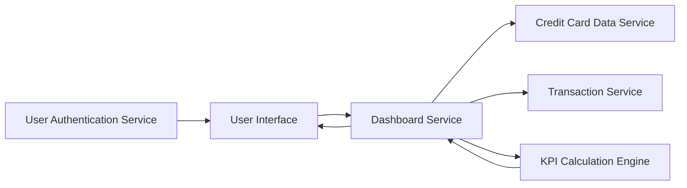

#### 1. High-Level Design

- **Summary:** This epic creates a centralized, responsive dashboard that provides real-time visibility into critical credit card financial KPIs across all user credit cards. The dashboard displays four key metrics: Monthly Spend, Total Credit Limit, Available Credit, and Outstanding Amount. The solution delivers a consolidated multi-card view with modern, responsive design supporting desktop, tablet, and mobile devices, enabling users to monitor their credit utilization and financial health at a glance.

- **Component Flow:**

- **Integration Points:**
  - **Upstream:** Credit Card data service (provides card details, credit limits, and current balances)
  - **Upstream:** Transaction service (provides spending data for Monthly Spend calculation)
  - **Upstream:** User authentication service (ensures secure access to user-specific dashboard data)

- **Key Assumptions:**
  - KPI calculations (Available Credit = Total Credit Limit - Outstanding Amount) are performed by the KPI Calculation Engine in near-real-time based on data freshness from upstream services.
  - Multi-card aggregation assumes all cards belonging to a user are identifiable through the User Authentication Service and retrievable from the Credit Card data service.

- **NFR Highlights:** Dashboard must be responsive across desktop, tablet, and mobile devices; KPI calculations must reflect real-time or near-real-time data; system must support concurrent viewing by multiple users.

- **Data Flow:** User authentication is validated through the User Authentication Service before dashboard access. The Dashboard Service retrieves card details and limits from the Credit Card Data Service and spending data from the Transaction Service. The KPI Calculation Engine processes this data to compute Monthly Spend, Total Credit Limit (aggregated across all cards), Available Credit, and Outstanding Amount. Calculated KPIs are returned to the Dashboard Service and rendered in the responsive User Interface, updating in near-real-time as underlying data changes.

#### 2. Validation Report

- **Requirements Coverage:** The design comprehensively addresses all scope items including Monthly Spend KPI display, Total Credit Limit aggregation, Available Credit calculation and display, Outstanding Amount tracking, responsive dashboard layout, and consolidated multi-card view. NFRs for responsive design across devices, real-time/near-real-time data, and concurrent user support are incorporated through the architecture. All stated dependencies (Credit Card data service, Transaction service, User authentication service) are integrated. Out-of-scope items (real bank integration, payment processing, fund transfers, loan management, payment gateway integration) are explicitly excluded.