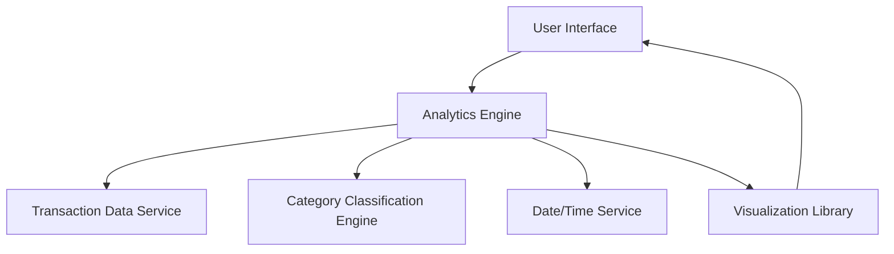

#### 1. High-Level Design

- **Summary:** This epic delivers a comprehensive spending analytics platform that enables users to visualize and analyze their credit card transactions across 9 predefined spending categories (Food & Dining, Fuel, Shopping, Travel, Entertainment, Utilities, Healthcare, Education, Miscellaneous). The system provides monthly spend trend analysis through interactive charts and graphs, allowing users to drill down into specific categories and time periods to understand spending patterns and identify optimization opportunities.

- **Component Flow:**

- **Integration Points:**
  - **Upstream:** Transaction data service (provides categorized transaction records)
  - **Upstream:** Date/time service (for temporal trend analysis)
  - **Upstream:** Category classification engine (for automatic expense categorization)
  - **External:** Visualization library (for rendering interactive charts and graphs)

- **Key Assumptions:**
  - Transactions are pre-categorized by the upstream Transaction data service or Category classification engine; the analytics engine does not perform initial categorization logic.
  - Monthly aggregation is based on transaction date; data is assumed to be available in near-real-time with acceptable latency for analytics processing.

- **NFR Highlights:** Analytics visualizations must load within acceptable response times even with large transaction datasets; category classification must be accurate and consistent; interactive charts must be responsive and support touch gestures on mobile devices.

- **Data Flow:** Transaction data flows from the Transaction data service to the Analytics Engine, where it is processed and aggregated by category and time period using the Date/time service. The Category classification engine ensures consistent categorization across all transactions. Processed data is then passed to the Visualization Library, which renders interactive charts and graphs displayed in the User Interface. Users can interact with visualizations to drill down into specific categories, triggering new data requests through the Analytics Engine.

#### 2. Validation Report

- **Requirements Coverage:** The design fully covers the epic's stated scope including category-wise spending visualization across 9 categories, monthly spend trends analysis, interactive charts and graphs, transaction categorization, spending pattern identification, time-based trend analysis, and category drill-down capabilities. All NFRs regarding performance, accuracy, and mobile responsiveness are addressed through the component architecture. Integration dependencies with Transaction data service, Date/time service, Visualization library, and Category classification engine are clearly mapped.