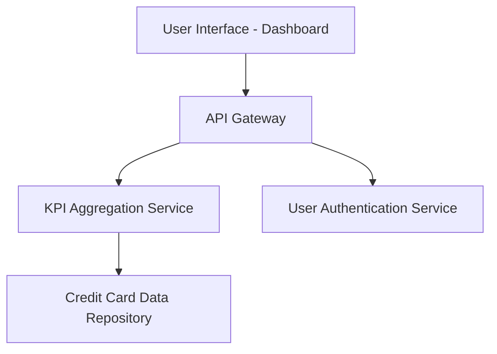

### 1. High-Level Design

**Summary:**  
This epic delivers a consolidated dashboard that displays key performance indicators (KPIs) for a user's credit card portfolio. The dashboard provides real-time visibility into monthly spend, total credit limit, available credit, and outstanding amounts across all credit cards, enabling users to monitor their financial health and make informed credit management decisions.

**Component Flow:**

**Integration Points:**
- **Upstream:** Credit card data source system (provides raw credit card data and transaction information)
- **Upstream:** User authentication service (validates user identity and authorization)
- **Internal:** Data aggregation service for multi-card calculations (computes consolidated KPIs across multiple cards)

**Key Assumptions:**
- Credit card data is refreshed at regular intervals (assumed near real-time or batch updates every few minutes) to support the "real-time data refresh capability" NFR.
- KPI calculations (monthly spend, available credit, outstanding amounts) follow standard financial formulas and are performed server-side.

**NFR Highlights:**  
Dashboard must load within 2 seconds; responsive design across desktop and mobile devices; real-time data refresh capability; support for concurrent users.

### 2. Validation Report

**Requirements Coverage:**  
The design covers all stated scope elements: dashboard interface, monthly spend calculation, total credit limit aggregation, available credit computation, outstanding amount tracking, responsive layout, and multi-card consolidated view. The architecture supports the NFRs by separating concerns (API Gateway for routing, KPI Aggregation Service for computation, data repository for storage) and enabling concurrent access. The integration points align with specified dependencies (credit card data source, user authentication, data aggregation service).