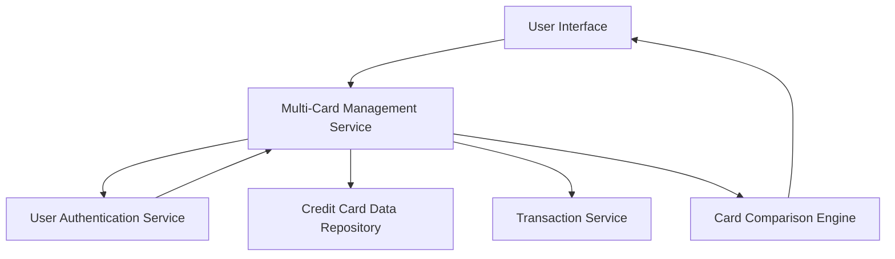

#### 1. High-Level Design

- **Summary**: This epic allows users to manage and monitor multiple credit cards (minimum 10 per user) from a unified interface. Users can view all cards, access card-specific details (credit limits, balances, utilization rates), perform card-wise spend analysis, and compare spending patterns across different cards for strategic decision-making.

- **Component Flow**:

- **Integration Points**: 
  - **Upstream**: Credit Card Data Repository (provides card information for all user cards)
  - **Upstream**: User Authentication Service (ensures secure card access)
  - **Upstream**: Transaction Service (provides card-wise spending data)
  - **Internal**: Card Comparison Engine (enables comparison capabilities across cards)

- **Key Assumptions**: 
  - Each user has a unique identifier linking to their credit cards; card data is stored with user association in the repository.
  - Card utilization rate is calculated as (outstanding balance / credit limit) * 100; refresh occurs on-demand or periodically within 3 seconds.

- **NFR Highlights**: System must support minimum 10 credit cards per user; card data refresh within 3 seconds; interface maintains performance with multiple cards displayed simultaneously.

- **Data Flow**: User logs in via Authentication Service → Multi-Card Management Service retrieves all associated cards from Credit Card Data Repository → For each card, service fetches card-specific spending data from Transaction Service → Card Comparison Engine processes data for comparative analysis → UI displays consolidated multi-card view with individual card details, spend analysis, and comparison metrics → User interacts with card-specific views and comparisons.

#### 2. Validation Report

- **Requirements Coverage**: The design fully addresses the epic's scope including multiple credit card display, card-wise spend analysis, individual card details view, card-specific credit limit tracking, card-specific outstanding balance display, and card comparison capabilities. All NFRs (support for minimum 10 cards per user, 3-second refresh time, performance with multiple cards) are incorporated through scalable service architecture. All stated dependencies (credit card data repository, user authentication service, transaction service) are properly integrated.